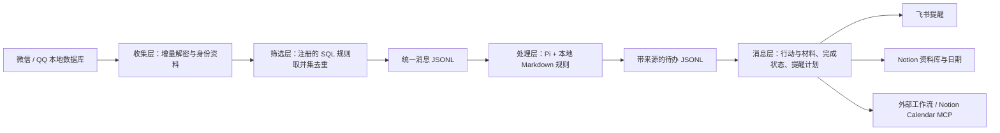

# 聊天收集与待办

从微信、QQ 本地消息中筛选有用内容，按本地 Markdown 规则提取待办，再整理成可以执行、携带材料的任务，交给飞书、Notion 或外部消息模块。

项目位于 `D:\opt\chat-collector`。采集和筛选不使用 AI；处理层使用 Pi 原生会话、附件工具和上下文压缩；消息层不调用模型。调试台是 `tools/console` 下的可选工具，关闭它不影响独立运行的核心。



## 当前能力

| 模块 | 已实现 | 配置与说明 |
|---|---|---|
| 收集 | 微信、QQ 首次完整解密；后续变化页刷新、失败回滚，保留已验证快照 | [增量刷新](docs/incremental-refresh.md) |
| 筛选 | 每轮数据库时间窗；独立 SQL 规则；合并去重，保留命中规则 | [规则集](FILTERS.md) |
| 处理 | P0–P4、时间、参与人员、地点、执行步骤、来源引用；Pi 按需读附件、查完整待办库 | [处理说明](docs/processing.md)、[提取规则](processing-rules/default.md) |
| 消息 | 消费正式待办输出；独立完成状态、稍后提醒、失败退避、材料与成果归档 | [消息层契约](docs/messaging.md) |
| 渠道 | 飞书机器人提醒、Notion SDK 页面和文件、统一 Webhook 接口 | [渠道配置](docs/messaging-channels.md) |
| 调试 | 本机面板与 OpenAPI；预览、手动处理、工具活动、材料下载与完成操作 | [调试工具](tools/console/README.md) |

**人员指需要参与事项的人，不等于负责人。** 发信人单独保留在来源中；只有明确指派时才标注负责人。未知内容不猜测，有歧义的待办显示具体复核原因。

Notion Calendar 有两条路径：将带 Date 属性的 Notion 数据库连接到 Calendar；或让已有、经用户 OAuth 授权的 MCP 工作流创建和更新真实日历事件。本项目提供后者的统一 Webhook 接入契约，尚未配置用户授权工作流。两者不能混称为同一种同步。

## 启动与日常操作

在项目根目录运行。当前本机 Python 为 `C:\veighna_studio\python.exe`，可代替下列 `python`。本地 `runtime-deps` 中包含 SQLCipher 等依赖；迁移机器时需重新安装匹配版本。

```powershell
cd D:\opt\chat-collector
$env:PYTHONPATH="$PWD/runtime-deps"

# 各层独立运行；调试台不是依赖
python -m collector once --config config/wechat.toml
python -m collector once --config config/qq.toml
python -m processor preview --config config/processor.toml
python -m processor once --config config/processor.toml

# 消息层预览不写状态、不联网；sync 只导入并保存本地材料
python -m messaging preview --config config/messaging.toml
python -m messaging sync --config config/messaging.toml
python -m messaging status --config config/messaging.toml

# 可选调试台：http://127.0.0.1:10400
.\tools\console\start.cmd
```

`collector`、`processor` 和 `messaging` 的 `run` 模式分别按各自配置间隔循环。`run.cmd` 是采集层快捷入口；运行处理或消息层用 `python -m ...`。后台启动时使用隐藏窗口，避免抢焦点；本轮未新增开机任务或外部提醒进程。

首次 QQ 取钥使用 `tools/qq-recover.cmd`，需要以管理员身份运行并保持 QQ 登录。已有合法密钥后的日常采集不需要反复扫描进程。微信媒体解码由采集提供方处理，处理层通过附件编号请求，不直接操作原始数据库。

## 配置

| 文件 | 用途 |
|---|---|
| `config/wechat.toml` / `config/qq.toml` | 数据目录、扫描间隔、刷新间隔、解码强度、SQL 注册表 |
| `config/processor.toml` | 模型、Pi 上下文预算、处理批次、附件提供方 |
| `processing-rules/default.md` | 行动判断、优先级、时间与参与人员、材料选择 |
| `config/messaging.toml` | 输入、独立状态库、材料目录、P0–P4 提醒间隔、目标注册表 |
| `.env` | 本地凭据；参考 [.env.example](.env.example)，不要提交真实值 |

消息层及所有渠道默认 `enabled=false`。本地预览和材料整理无需填写外部凭据。准备投递时，安装 `messaging/requirements.txt`，填写目标并同时启用全局和目标，再运行 `python -m messaging once` 或 `run`。当前示例提醒间隔为 P0 一小时、P1 四小时、P2 一天、P3 一周、P4 不重复提醒；全部可改，`0` 表示只同步首次和修订。Notion 与 `mode="sync"` 工作流仅同步变化，不按提醒频率反复新建页面或日程。

处理层仅消费已发布采集结果；采集失败不会自动阻止已有待办处理。消息层仅消费已发布正式待办，调试批次不会自动外发。更改 Markdown 规则会改变处理指纹，历史分组可能重新待处理并产生模型费用；本轮没有自动重跑模型。

## 材料、链接与完成后的成果

- 待办按“动作 → 执行步骤 → 参与人员/时间/地点 → 所需材料和链接”展示。程序补全来源，模型不能指定本地路径。
- AI 通过 `material_refs` 选择执行所需附件；已读并引用的附件证据也关联材料。来源消息里的其他附件不自动上传，旧待办可重新处理以补齐材料关系。
- 消息层将选中的、已验证归档复制到 `data/messaging/assets/<内容哈希前两位>/<内容哈希>`，相同内容只存一份，原文件名保留在清单。即使原聊天缓存被清理，已保存副本仍可用。
- 链接从支撑待办的原消息提取，不自动访问网页。缺原件、密文、校验不符和缩略图都有状态提示，不冒充完整材料。
- Notion 可托管上传的文件；首版单文件最多 20 MiB。飞书机器人 Webhook 本身不能上传文件，需外部应用工作流实现文件投递；本机路径不会被包装成公网下载地址。
- 完成状态、成果材料和投递回执保留在消息层。完成后停止重复提醒，不删除附件或原始来源。

```powershell
python -m messaging attach-result --task-id "待办ID" --file "D:\work\已填申请表.docx" --note "已填写，待核对"
python -m messaging complete --task-id "待办ID"
python -m messaging reopen --task-id "待办ID"
python -m messaging snooze --task-id "待办ID" --until "2026-11-14T09:00:00+08:00"
```

## 数据边界与风险

| 边界 | 保证与限制 |
|---|---|
| 采集 → 处理 | 统一消息契约，按事件 ID、消息 ID 与修订去重；原始 SQL 架构由收集方处理 |
| 处理 → 消息 | 统一待办事件；按事件 ID 去重、按任务修订更新；乱序不回退，同修订冲突拒绝 |
| 外部投递 | 持久记录投递 ID、目标与回执；明确失败退避，结果未知停止自动重发。不能保证所有外部平台“恰好一次” |
| 完成状态 | 消息层本地标记不被新内容修订静默覆盖；外部平台手动完成状态尚未自动回流 |
| 隐私 | 远程模型会收到选中聊天及实际读取的附件；启用渠道后相应任务和材料会离开本机 |
| 本地存储 | 聊天、待办、附件与凭据均为敏感数据。归档不会自动清理，需规划磁盘与备份；不要删除原项目 output 或现有 data |
| 模型判断 | 去重与证据校验不能保证语义判断永远正确；复核项需要人工确认 |

`.env`、`secrets/`、`data/`、本地依赖和运行日志均不进入 Git。首次部署先预览，确认筛选范围和目标；外部账户、权限、配额和实际通知到达需配置后联调。

## 开发与文档

目录：`collector/` 收集与 SQL 执行，`rulesets/` SQL，`providers/` 附件提供方，`processor/` Pi 处理，`messaging/` 独立消息核心和渠道，`tools/console/` 可选调试台，`tests/` 合成测试。

- [文档索引](docs/README.md)
- [提供方契约](docs/data-contract.md) · [收集层开发指南](docs/collector-development.md)
- [消息层契约、恢复和扩展](docs/messaging.md) · [Notion/MCP 与渠道指南](docs/messaging-channels.md)
- [行动输出开发说明](docs/actionable-tasks.md) · [Pi 运行时](docs/pi-runtime.md)

```powershell
$env:PYTHONPATH="$PWD/runtime-deps"
python -m pytest tests tools/console/tests -q
```

测试使用合成数据、模拟模型或 HTTP 服务，不代替真实模型质量、平台权限及通知到达验收。
