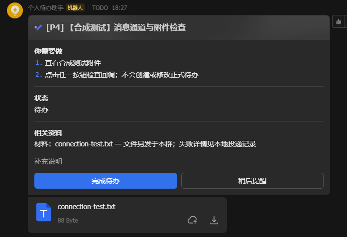
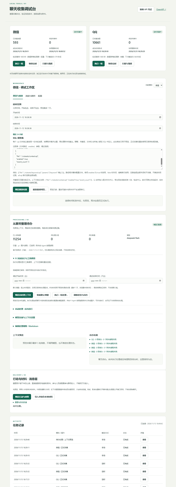

  

<h1 align="center">拾序 · Loose Ends</h1>

<strong>把零散信息，理成下一步。</strong>

本地采集 · SQL 筛选 · 自定义规则 · 多渠道提醒

  <a href="#快速开始">快速开始</a> ·
  <a href="FILTERS.md">SQL 筛选</a> ·
  <a href="processing-rules/default.md">待办规则</a> ·
  <a href="docs/README.md">完整文档</a>

从不同来源的信息中整理个人待办，保留材料与来源。内置微信、QQ 本地采集，支持接入其他消息来源，并将结果交给飞书、Notion 或自己的应用与通知平台。

## 看看效果

**飞书卡片与附件（合成测试）**：展示行动说明、随附材料，以及“完成待办 / 稍后提醒”入口。

查看本地调试台：采集状态、SQL 预览、待办处理与任务记录

## 为什么用它

- **本地解密，减少账号交互**：读取本机微信、QQ 数据库，不通过聊天账号模拟收发消息。采集与筛选不使用 AI；账号风险边界见下文。
- **各层解耦，方便接入**：采集、处理、消息投递可独立运行；通过统一契约接入新的消息平台、自定义收集器和附件提供方，也可通过 Webhook 或 Python 适配器将待办接入自己的应用、工作流或通知平台。
- **增量处理，节省解密与 Token 开销**：首次完整解密，后续复用快照、刷新变化页；只为选中消息处理附件，模型按需读取内容，未变化的分组不重复调用模型。
- **直接写 SQL 筛选**：用 SQLite 原生查询表达群聊、关键词、文件和上下文条件，多条规则合并去重；支持预览与重放，无需学习额外的筛选语法。详见 [SQL 规则](FILTERS.md)。
- **消息与待办都有来源**：保留原消息身份、会话、时间和命中规则；待办关联支撑它的消息与附件证据，方便回查依据。
- **按你的习惯安排待办**：直接编辑 [Markdown 规则](processing-rules/default.md)，自定义什么算待办、P0–P4 优先级、时间与材料提取；提醒频率也可单独调整。

流程：**本地聊天库 → SQL 筛选 → 自定义规则 + 模型 → 带来源的待办与材料 → 通知平台**。

## 快速开始

当前提供 **Windows x64 本地使用预览包**，安装需要联网。

1. 按 [安装指南](docs/installation.md) 准备预览包，解压后双击 `Install.cmd`，选择空目录安装。无需预装 Python、Node 或编译器。
2. 按引导选择微信 / QQ，完成首次取钥，填写模型配置；飞书可选，稍后也能接入其他渠道。
3. 引导首次处理最近 7 日符合 SQL 规则的消息；日常双击 `Start.cmd`，在本地调试台查看状态、预览筛选和调整规则。

源码安装与分层运行见 [开发指南](docs/development.md)。源码目录的 `Install.cmd` 使用已有发布 ZIP，缺包时需先按安装指南构建。

## 按需调整与扩展

| 想做什么 | 从这里开始 |
|---|---|
| 只收集指定群、关键词、文件或上下文 | [SQL 规则](FILTERS.md) |
| 自定义待办判断、优先级与模型 | [默认规则](processing-rules/default.md) · [处理配置](docs/processing.md) |
| 配置飞书、Notion、提醒与操作反馈 | [渠道配置](docs/messaging-channels.md) · [飞书设置](docs/feishu-setup.md) |
| 接入其他消息来源或通知平台 | [收集层开发](docs/collector-development.md) · [数据契约](docs/data-contract.md) · [渠道开发](docs/channel-development.md) |
| 设置自动运行、失败重试与恢复 | [自动化](docs/automation.md) |

## 使用边界

- **账号与兼容性**：本地解密减少了与平台服务的交互，但没有封号率实测，不能保证零风险。首次取钥涉及微信 Hook 或 QQ 进程内存读取；客户端升级可能影响兼容性。
- **隐私与费用**：配置远程模型后，选中消息及实际读取的附件会发到该服务；启用通知渠道后，相应待办和材料会离开本机。修改待办规则可能重新处理历史分组并产生费用。
- **结果与数据**：模型可能误判，需结合来源核对。聊天、附件和凭据均属敏感数据，请保管好 `.env`、`secrets/` 与 `data/`；已有部署请勿用新包直接覆盖。

更多说明见 [文档索引](docs/README.md)，增量机制与实测见 [增量刷新](docs/incremental-refresh.md)。
