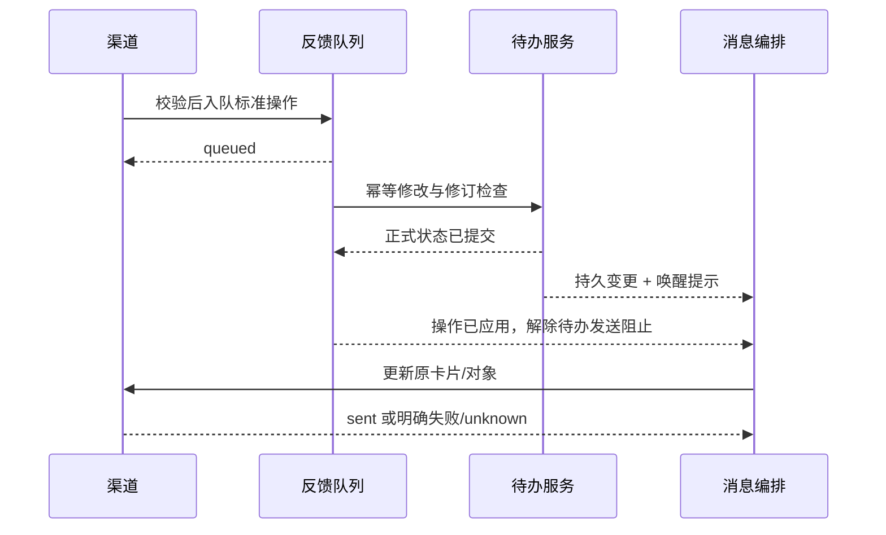

# 架构候选实现与迁移指南

本轮按 [架构书 B01–B13](architecture.md#不可偏移的决策) 实施，代码只在隔离候选分支中运行。生产目录、测试安装的账号配置、真实数据库和后台服务未被替换。原生 Code Review / Security Review 尚未配置；本地测试与独立 Agent 审查不能代替它们，也不能代替用户最终验收。

## 实际职责与入口

| 层 | 入口 | 拥有的工作 |
|---|---|---|
| 收集 | `collector.service.collect_once(config)` | 原生增量刷新、已验证来源、独立采集进度；无需规则或模型 |
| 兼容查询 | `providers.query.query_rules(scope, window, rules)` | 来源快照、平台字段映射、临时 SQLite、参数绑定、只读执行、身份补全 |
| 兼容内容 | `providers.content` | 附件配置、按引用定位、按需准备/解码、内容读取、材料导出与缓存 |
| 筛选 | `selection.run_round(config, start=None, end=None)` | 加载 SQL 注册表、合并各规则命中、去重、筛选断点和事件发布 |
| 应用编排 | `application.collection.run_round` | 组合采集与筛选，保持旧 `collector once/run` 命令和节流行为 |
| Pi | `processor.core`、`processor.context`、现有 Node 运行时 | 上下文组装与原生工具循环；工具只调用公开内容/任务入口 |
| 待办服务 | `processor.service` | 正式任务、人工控制、幂等操作、事务、变更读取和材料归属 |
| 消息编排 | `messaging.core`、`feedback` | 消费变更、通知计划、持久反馈/投递队列、重试与投递包 |
| 渠道 | `messaging.feishu`、`channels` | 平台校验、卡片/页面、文件上传和回执；不修改正式待办表 |
| 自动运行 | `automation` | 独立任务调度、重试预算、报警和本机即时唤醒 |

QQ/微信消息读取、字段映射以及高级附件定位/解码/归档在 `providers/platforms/`；原 `collector.adapters.*.scan` 与 `collector.assets.AttachmentArchive` 只保留兼容转发。原生刷新仍在收集层。归档直接迁移现有实现，继续复用 `collector.asset_vendor` 底层引擎。公共锁和稳定序列化在 `common/`，不依赖业务层。

旧导入 `collector.filters`、`collector.store`、`collector.identities`、`collector.attachment_provider`、`processor.actions` 继续可用；新开发使用上表入口，不在兼容包装里新增业务。

组合 CLI 和后台入口先独立采集，再加载 SQL；没有规则或 SQL 文件失效都不停止来源维护。`refresh_interval_seconds` 按来源的最近采集完成时间节流，和各筛选断点分开；规则恢复后，在采集等待期间也能消费已经发布但尚未筛选的窗口。显式重放仍强制采集，并更新实际采集时间。

## SQL 与消息契约

```python
from providers.query import query_rules

result = query_rules(
    {"provider_id": "qq", "platform": "qq", "account_id": account_id,
     "config": collector_config},
    {"start_inclusive": start, "end_exclusive": end},
    registered_rules,
)
# result: snapshot_id、messages[{identity,message_key,message}]、hits[{identity,rule_id}]
```

`registered_rules` 沿用 SQL 文件、`params`、`recent_count` 和 `provenance`，另有稳定 `id`。参数原样绑定，不为关键词或新参数逐个新增适配分支。SQL 只能返回 `identity`，不能写库、附加数据库或加载扩展；返回不存在的消息身份会失败。

所有规则查询相同输入。筛选层按消息身份合并结果，保存全部实际命中的 `matched_rules`；一条消息不会因为被规则 A 命中而从规则 B 输入中移除。任一规则失败都不推进筛选断点。文件/全员提及触发消息和同会话上下文同时保留；关键词仍只匹配当条正文。

`selection/store.py` 继续使用原数据库和 ID 算法，事务提交断点与 outbox，文件发布失败后重试恢复。显式时间重放不会推进定时断点。独立采集进度与筛选进度分开，不能把“采集结束时间”当成所有消息都已覆盖的时间。

连续性事实 `source.selection_context` 参与语义摘要：迟到但未被 SQL 选中的行改变前驱时，重放会发布受影响消息的修订，处理层据此重建片段。库路径等内部来源信息仍不参与摘要。旧摘要首次遇到相同消息时，从不可变 outbox 核对原连续性并更新去重记录，不因升级单独重发事件。

受采集器管理的定时筛选，结束时间上限为已发布快照的 `capture_started_at`。SQL 返回的快照编号必须与附件准备阶段相同，且其时间水位仍覆盖该窗口；否则整轮失败、不推进断点。外部 `resource_db`、同目录 `hardlink.db` 及 WAL/journal 也参与快照检查。旧版本采集元数据缺少水位时先采集一轮；不补造覆盖时间。外部提供方可在快照对象实现 `selection_window_end(requested_end)` 提供自己的覆盖上限。

采集发布记录现位于来源目录 `.collection.json`（仅配置单库时为库路径加 `.collection.json`），多个筛选状态共享它；旧状态库旁记录仍可读取，下一次成功采集写入来源位置，保留旧文件。刷新前持久记录 `.pending.json`。多分片中途失败或进程中断时，每个已提交库仍由原生引擎保证有效，但混合库组不能冒充上次完整快照：查询、显式重放和附件准备均拒绝，下一次采集复用既有增量状态完成并发布整组后恢复。失败且来源完全未变化时，原已发布视图仍可读取。这里没有保留旧整组的独立副本，也不增加每轮整库复制。

新平台注册快照工厂：`providers.query_registry.register_query_provider(id, factory)`。工厂返回带 `snapshot_id`、`scan()`、`enrich()` 的上下文管理器；标准消息、身份、会话边界由提供方保证。合成第三来源测试执行原有 SQL，并进入现有处理和消息链路，无需修改 Pi 或消息核心。

## 公开待办接口

| 接口 | 说明 |
|---|---|
| `get_task(config, task_id)` | 正式任务及稳定材料编号 |
| `search_tasks(config, **filters)` | 沿用时间、平台、会话、关键词、人物、级别、状态等查询和分页 |
| `create_tasks(config, tasks, request_id=..., actor=..., origin=...)` | 人工/渠道创建；明确来源，不得冒用聊天证据 |
| `apply_extraction(config, submission, request_id=..., context=...)` | 接收既有映射后的 Pi 提交，校验已入库会话证据后保存 |
| `update_task_status` / `update_task_priority` | 请求编号、操作者、预期修订；人工修改保留到后续 AI 更新 |
| `read_changes(config, cursor=None, limit=100)` | 返回 `events`、`next_cursor`、`has_more`，消费方原样保存游标 |
| `get_material(config, task_id, material_id)` | 先校验任务归属，再交兼容层验证归档或按需准备 |

同一请求重复提交返回原回执；同号不同内容拒绝。任务、审计/回执、outbox 在同一事务内保存。变更接口可以读到已提交但尚未导出 JSONL 的事件，导出故障不再成为消息消费的必经阻塞点。

模型轮次、短任务写入、文件导出分别用锁；模型和附件操作不占用任务写锁。提交时重新读取正式任务：人工完成、恢复、改级保留；与其他处理结果冲突的旧提交拒绝，不覆盖新内容。

附件初始只给索引。Pi 的 `read_attachment` 用短编号调用 `providers.content`，不自行定位/解密/解析。导出任务材料不代表 AI 已读过它，不生成虚假的阅读证据；缺失附件返回明确状态，不阻断其他任务的发送。

## 消息消费与回调

```toml
[input]
processor_config = "processor.toml"
```

启用反馈的旧配置会自动使用 `feedback.processor_config` 作为读写的同一正式来源；显式配置的读取来源必须与反馈来源一致。无此配置、且关闭反馈的旧独立 JSONL 用法仍可用，通过公开的 `processor.publication` 兼容接口读取。

服务模式中，投影与消费游标同事务提交；历史 JSONL 事件切换到变更接口仍按原事件编号去重。旧消息库里的 `local_state.completed` 不再覆盖正式状态。只关闭反馈队列也不会把完成操作退回另一个“正式状态”。

回写路径：



入队成功不是修改成功，修改成功也不是发送成功。反馈重试不等于投递重试；投递失败不重复执行业务修改。飞书继续使用原状态数据库位置和 token/卡片代次/上传回执，但连接与平台表由渠道代码自己管理，旧按钮无需批量作废。

## 唤醒、提醒与恢复

`automation.wakeup.notify(config_path, job)` 仅接受 `feedback` / `messaging`，经认证令牌通知随机端口的本机回环 UDP 监听，不携带聊天正文，不触发模型。调度器继续使用 APScheduler；信号只是加速提示，持久队列和原定时轮询负责恢复。

- 禁用、暂停、重试等待、投递 `unknown` 保护不被唤醒绕过。
- 执行期间收到的唤醒计入持久序号，完成后再调度；不并发执行同一个任务。
- 元数据位于相关配置旁的隐藏 `.wakeup.json` 文件，不含账号密钥，已加入 Git 忽略；监听退出时清理自己的文件。
- `transport_started_at/transport_finished_at` 记录实际网络调用起止；旧历史记录为空，不能推算过去的真实延迟。
- P0/P1 的截止节点、其他档位、首次通知、每日早报范围与用户配置保持原规则。唤醒不提前发送未来节点。

## 升级与回退

验收部署前先停止目标安装自己的后台任务，备份该安装的配置和 SQLite 状态文件；不得复制正在写入中的数据库当成一致备份。生产服务本轮未停机、未部署。

新增结构为追加表/字段：任务操作回执、消息消费游标、自动化唤醒序号、真实投递时刻和采集元数据。没有重建已有任务/消息 ID、删除数据、重采历史或重复发送。旧导入仍可运行。

回退代码可以忽略多数新增字段，但不能一边运行新版本一边让旧版本修改同一数据库；若候选已产生新业务数据，应在停机后先导出/核对，再决定回退代码或恢复备份，不能直接用旧备份覆盖新数据。

## 验证范围

回归覆盖来源增量、SQL 隔离、多规则去重、附件缓存、真实 Pi SDK 的模拟模型循环、人工并发修改、变更分页/回放、反馈鉴权、提醒节点、未知发送结果、配置与面板。端到端使用合成第三来源和模拟渠道，不消费真实聊天或模型额度。

本机唤醒分两段各测 20 次，测试报告记录 p95；它不代表飞书端到端耗时。源码、解压后产物、真实账号、真实 GUI 与开机验收分别记录。最终源码与产物校验值见候选验收记录；未进行的验证不得沿用旧安装包结论。
