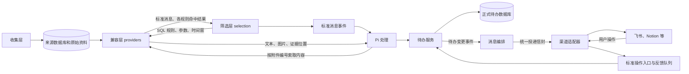
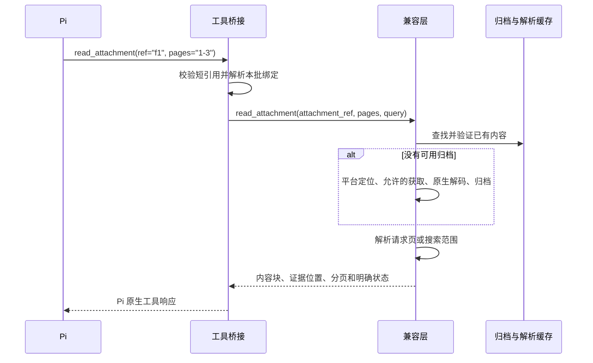
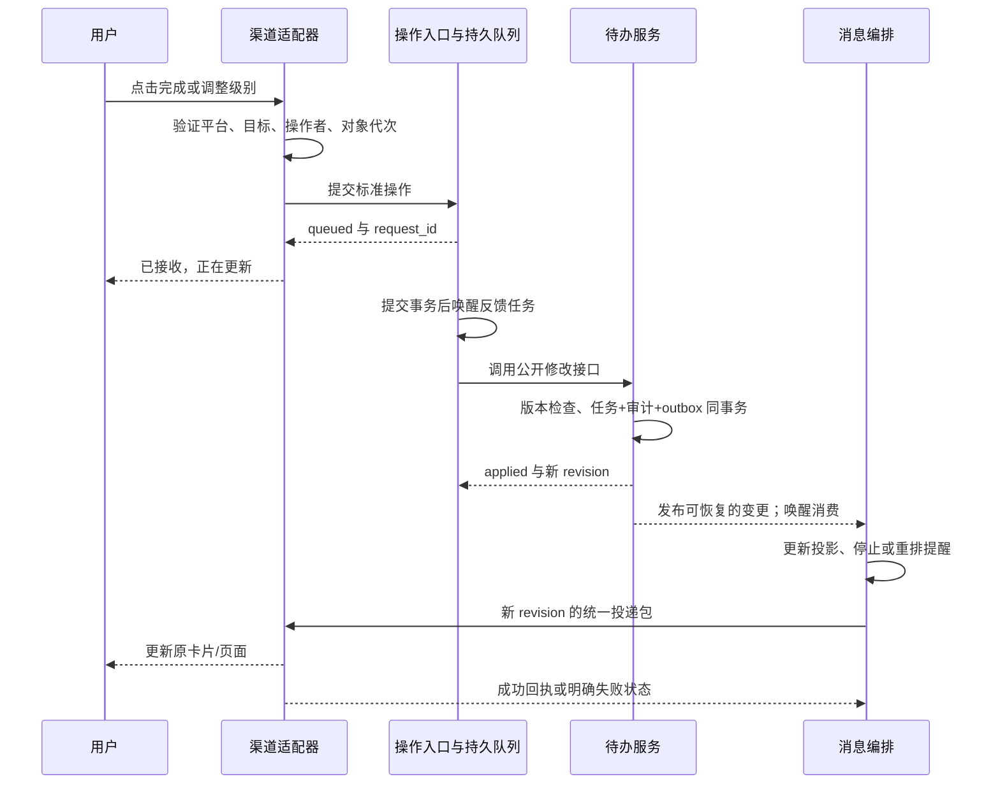

# 目标架构与边界契约

版本：1.0；制定日期：2026-11-13。

本文固定用户确认的架构边界，不把目标与生产部署混为一谈。用户已批准候选实施；实际入口、迁移与验证限制见 [候选实现与迁移](architecture-implementation.md)，分工见 [Agent 任务](architecture-agent-tasks.md)。生产是否升级以验收记录为准。

发生冲突时：用户最新明确要求优先；架构重构以本文的目标边界为准；现有实现文档只描述迁移前行为。不得因为旧代码方便调用而沿用错误依赖，也不得把尚未实现的目标写成现状。

## 导航

- [不可偏移的决策](#不可偏移的决策)
- [模块职责与依赖](#模块职责与依赖)
- [数据所有权](#数据所有权)
- [SQL 查询契约](#sql-查询契约)
- [附件内容契约](#附件内容契约)
- [Pi 与待办服务](#pi-与待办服务)
- [消息编排与渠道契约](#消息编排与渠道契约)
- [渠道操作回写](#渠道操作回写)
- [调度、失败和可观测性](#调度失败和可观测性)
- [当前差距与迁移要求](#当前差距与迁移要求)
- [最终验收](#最终验收)

## 不可偏移的决策

| 编号 | 必须满足 |
|---|---|
| B01 | 保持一个本地 Python 项目和现有 Pi Node 运行时。逻辑解耦不要求微服务、多仓库、新消息中间件或独立面板项目。 |
| B02 | 收集层负责获取源信息、维护可验证的数据库/原始资料及采集进度。不得依赖 SQL 业务规则、AI、待办或消息渠道。 |
| B03 | **兼容层负责数据库差异适配、统一 SQL 查询环境、临时 SQLite 表、参数绑定和 SQL 执行。**筛选层只拥有筛选策略和规则编排，不能自己创建适配表、打开平台数据库或改写平台字段。 |
| B04 | **Pi 循环与工具不负责附件定位、下载、解密、解码、格式识别和文档解析。**工具向兼容层索取内容，兼容层自行完成准备、解析、缓存与失败处理。 |
| B05 | 收集、兼容、SQL 筛选、任务持久化、消息编排和渠道不使用 AI。自然语言判断只发生在 Pi 处理环节。 |
| B06 | 处理层要求输入符合契约；不补查平台联系人，不修补 QQ/微信私有字段，不通过定时处理隐式刷新采集库。 |
| B07 | 正式待办只有一个权威数据库和一组公开业务接口。Pi、消息层、渠道、面板均不得绕过它直接写表。 |
| B08 | 消息层负责何时通知、向哪些已配置目标投递、重试与去重；渠道负责如何呈现、发送、上传和解释回调。 |
| B09 | 人工完成和人工优先级对同一待办持续生效；AI 更新不得覆盖。完成统一停止提醒，不新增忽略/丢弃状态或人工审核门槛。 |
| B10 | 多规则查询同一时间窗、同一可验证快照；结果合并去重，保留全部实际命中规则。不能先让某条规则消费掉其他规则的输入。 |
| B11 | 复用 Pi 原生工具循环、上下文与压缩；附件初始只给索引，按需读取，不强制读取全部附件，不把草稿和内部调试记录塞进上下文。 |
| B12 | 调试台和安装器只是客户端。关闭面板不停止后台，不影响正确性；核心包不得反向导入 `tools/console` 或 `tools/install`。 |
| B13 | 保留已有数据库、账号配置、密钥、断点、附件、规则参数、待办身份和回执。禁止借重构重采全量或自动重跑真实模型。 |

## 模块职责与依赖

用户的“处理层”是业务流程上的大类，其中筛选、Pi 和待办服务必须有独立代码边界。兼容层服务于多个调用方，不是 Pi 的一个内部工具实现。



| 模块 | 拥有的职责 | 禁止承担 |
|---|---|---|
| 收集 `collector/` | QQ/微信取钥入口、原生增量数据库刷新、已验证快照、采集断点、原始资料保存与必要平台元数据 | 执行用户 SQL 规则、产出待办、启动 Pi、安排通知 |
| 兼容 `providers/` | 读取来源库、平台字段映射、身份资料、统一 SQL 表/视图、查询执行、附件定位/按需准备/解码/解析 | 决定业务规则、判断优先级、直接写待办、投递消息 |
| 筛选 `selection/`（目标新增边界） | 规则注册、启停、时间窗、提交 SQL、合并命中、事件去重、筛选断点与发布 | 建立临时消息适配表、导入平台解析器、解析原始 SQL 行 |
| Pi `processor/` 的模型部分 | 标准消息上下文、Markdown 业务规则、Pi 调用、短引用、工具桥接、结构化提交校验 | 数据库解密、文件解析、决定外部通知时间、直接更新待办表 |
| 待办服务 `processor/` 的持久化/API 部分 | 创建/查询/修改待办、人工控制、证据关联、审计、修订、事务与变更发布 | 调用模型、操作平台消息、解析平台数据库 |
| 消息编排 `messaging/` 核心 | 消费待办变化、材料包、目标路由、提醒/早报、投递队列、反馈队列与重试 | 决定任务内容、修改来源消息、解码附件、使用渠道私有状态作为正式任务状态 |
| 渠道 `messaging/` 下适配器 | SDK 调用、呈现、材料上传、远端对象映射、平台鉴权、标准化操作和回执 | 直接读写待办库、独立制定优先级提醒规则、调用 Pi |
| 调度 `automation/` | 独立任务生命周期、唤醒、运行锁、退避、报警调度 | 藏入平台解析或任务判断规则 |
| 公共契约/基础设施 | 数据验证、错误码、稳定序列化、摘要、锁等无业务工具 | 注册渠道、打开业务库、在 import 时启动服务 |

依赖限制是对内部实现的限制，不禁止通过公开接口协作。应用组装入口可以注册具体提供方和渠道；Pi、筛选、消息核心不得按 `platform == 'wechat'` 分支加载具体实现。

目标依赖方向：

- 筛选 → 兼容查询接口；Pi 工具 → 兼容内容接口 / 待办接口。
- 消息 → 待办公开接口与变更流；渠道 → 标准消息、操作与回执契约。
- 兼容层 → 收集层公开快照/原始资料入口。可调用复用的原生引擎，但不能反向运行整轮采集。
- 待办材料入口 → 兼容附件接口，必要时索取已授权材料；任务状态接口不依赖附件成功。
- 收集层不得依赖以上消费者。跨层公共小工具移至无业务依赖的 `common/`；不得只把 import 换成动态加载来掩盖循环依赖。

## 数据所有权

| 数据 | 唯一写入方 | 对外访问方式 |
|---|---|---|
| 来源明文库、增量页状态、采集进度 | 对应收集模块 | 有版本标识的已验证快照；兼容层只读 |
| 来源文件、密文及凭据 | 对应收集模块/取钥入口 | 提供方受控读取；不传 AI 或渠道 |
| SQL 临时表、平台映射和身份缓存 | 兼容层 | 标准查询结果；不泄露连接对象 |
| 解码归档、解析缓存、附件定位映射 | 兼容层 | 不透明附件/材料引用及受控内容接口 |
| 规则命中、筛选断点、标准消息发布记录 | 筛选层 | 不可变消息事件批次 |
| Pi 会话、压缩状态 | Pi 原生运行时 | Pi 原生机制；调试面板只观察 |
| 正式待办、人工覆盖、来源证据、审计、待办 outbox | 待办服务 | 公开 API 和变更事件 |
| 待办投影、计划、投递和反馈队列、成果附件归档 | 消息层 | 消息层公开接口 |
| 平台 token 映射、卡片代次、上传缓存、远端回执 | 对应渠道 | 标准回执/操作；平台专属表归渠道管理 |

正式待办当前位于 `data/processor/state.db`，消息层状态位于 `data/messaging/state.db`，反馈队列位于 `data/messaging/feedback.db`。迁移不要求改这些路径。消息层的任务副本不是第二个权威库；旧 `local_state.completed` 只能兼容已存在的行为，正式反馈模式必须服从待办服务。

收集进度与筛选进度分开：收集成功不代表筛选成功。筛选失败时重试同一窗口，不要求重解密已验证来源库。筛选断点、输出事件及待发布记录同事务保存，之后原子发布 JSONL。发布失败不能丢失本轮消息。

文件内容与文件名分离：内部可以按内容摘要存储，外部必须带独立 `name` 和可用格式信息。摘要用于完整性与本地去重，不向 AI 暴露。消息层负责下载文件名、展示和渠道上传；不为补一个扩展名重新解码。

## SQL 查询契约

### 所有适配在兼容层内完成

筛选层向兼容层提交已注册规则，兼容层负责把不同来源变成规则可查询的统一表。

**临时 SQLite 表继续允许存在，但创建、填充、索引、平台映射、连接、SQL 执行和清理都归兼容层。**不能把这些逻辑留在 `selection`，也不能把 SQLite 连接交给筛选层自行执行。

第一版保留现有 SQLite SQL 方言、`messages`、`candidates` 和规则返回 `identity` 的约定。兼容层可以用视图或临时表实现；不要求任意 SQL 自动翻译为平台原表查询，不新增 JSON 规则语言或 SQL 翻译器。

### 目标调用接口

以下是待实施契约，普通 Python 数据对象即可；不要求引入框架或 HTTP 服务。

```python
query_rules(scope, window, rules) -> QueryResult

# scope: provider_id、platform、account_id
# window: start_inclusive、end_exclusive（Unix 秒，左闭右开）
# rules: [{id, file, sql, params, recent_count}]
# QueryResult:
#   snapshot_id: 本次一致快照标识
#   messages: [{identity, message_key, message}]  # 完整标准消息，已按稳定会话时序排列
#   hits: [{identity, rule_id}]
```

`id` 是本次规则注册项的唯一标识；同一个 SQL 文件用不同参数注册时必须能区分。`file` 是来源标记，SQL 内容由规则注册器读取；提供方不得依据消息内容选择执行文件。

| 约定 | 负责方 |
|---|---|
| 加载规则文件、注册项、启停和用户参数 | 筛选层 |
| 同一轮传入全部规则、确定扫描时间窗 | 筛选层 |
| 获取稳定来源快照、建立标准消息查询表 | 兼容层 |
| 保留参数原生绑定，不为每个自定义参数写适配 | 兼容层 |
| 绑定 `window_start/window_end/recent_count`，拒绝用户覆盖保留参数 | 兼容层 |
| 校验只读 SQL、禁止写表/ATTACH/危险扩展，校验只返回 `identity` | 兼容层 |
| 返回被命中消息及其附件索引、人物和时序事实 | 兼容层 |
| 合并多个规则结果，构造 `matched_rules` | 筛选层 |
| 发布前校验标准事件、生成修订和去重 | 筛选层 |

规则是本机受信任配置；聊天正文不得成为 SQL。所有值通过参数绑定传入；不支持的参数类型、输出列或 SQL 明确报错，不悄悄忽略。

### 时序、上下文与去重

1. `candidates` 是本轮 `[start,end)` 的消息；`messages` 包含这轮查询所需的有限历史。默认时间条件与其他条件一样由查询契约表达。
2. 多规则共享同一快照；所有规则成功后才允许提交本轮筛选断点。一个规则失败不发布看似完整的部分命中。
3. 上下 N 条限定同一平台、账号、会话。顺序由兼容层依据发送时间和稳定的源序列/消息 ID 决定；同秒消息不能随机换序。
4. `keywords` 只匹配当条正文；当前 `context` 以文件和全员提及为触发点，默认前后各五条，并包含触发消息本身。规则可分别注册、组合和关闭。
5. 只有本地已存在的后文能返回；下一轮到达的新消息若补全旧触发点邻域，可以再返回旧触发点与相关上下文。不能因为触发点早于本轮而丢掉它。
6. 同轮以稳定 `message_key` 合并命中，保留全部返回这条消息的规则；不得新增用户已否定的“触发原因”字段作为替代。
7. 跨轮用稳定事件身份和语义内容摘要判断新消息/修订，重复内容不重复发布。修订包含需要消费者看到的变化；规则结果变化不能覆盖旧事件文件。保持既有 `event_id/message_key/revision` 兼容。
8. 过滤后的消息未必连续。兼容层提供 `previous_message_key/previous_known` 等事实；Pi 输入构建器据此分段，不根据文本猜遗漏消息。
9. 来源库刷新按变化页面更新；筛选时间窗按消息时间执行。迟到消息和旧消息修改的回溯策略必须显式配置/重放，不宣称仅时间窗就能自动发现全部历史变更。

对外交付继续使用 [消息数据契约](data-contract.md) 的 `schema_version: 1` 和不可变 JSONL。兼容层返回的查询行不是最终事件；事件修订与发布归筛选层，避免提供方和筛选层各生成一套冲突的版本号。

## 附件内容契约

### Pi 工具只索取内容



| 接口（目标） | 输入和结果 |
|---|---|
| `read_attachment(ref, *, pages=None, query=None)` | `ref` 是兼容层持有身份绑定的不透明引用；返回所请求范围的文本/图片、证据位置、分页、状态与错误 |
| `export_attachment(ref)` | 返回已验证的可投递文件句柄/描述，含名称、媒体类型、大小和完整性信息；无需为发文件解析全部正文 |

兼容层拥有 `prepare_attachment` 的平台实现及共享解析器。现有 `providers/attachments.py`、`attachment_worker.py` 应继续复用成熟 PDF、Office、图片组件；共享原生解码能力也在此边界内调用，不改写引擎。

工具桥接只能做：短引用校验与映射、取消信号传递、调用内容接口、把结果包装为 Pi 原生内容块、登记实际读取的证据。禁止从工具导入 QQ/微信解码器、查路径、运行转换器或自行解析 PDF。

兼容接口返回与模型厂商无关的文本/图片描述，不导入 Pi SDK。桥接负责协议包装，不负责图片转码或文档解析；更换模型运行时不应要求重写提供方。

内容接口的结果至少包含：

| 字段 | 语义 |
|---|---|
| `status` | `ready/partial/unavailable/unsupported/retryable_error`；结果状态不代表待办需要人工审批 |
| `content` | 本次请求得到的文本或图片块；未读取内容不得假装已返回 |
| `evidence` | 对应的来源附件、页/块位置；由程序绑定，不由模型伪造 |
| `next_pages` / `total_units` | 支持时提供分页；未知总页数明确为空 |
| `error_code` / `retryable` | 稳定错误码及能否重试；文件缺失不是无限重试理由 |
| `material` | 可选的已验证归档描述，仅保留必要信息；路径、密钥和定位值不得进入 AI 上下文 |

边界要求：

- 原附件身份必须绑定提供方、账号、会话、消息和附件位置；同名文件不能互相替代。
- 附件可能来自本地路径、平台 ID 或链接，均由兼容层解释。普通 URL 不自动取得下载授权；第一版保留当前本地定位能力，未知/需登录下载的来源明确返回状态，不新增爬虫或云端下载功能。
- 先用已验证归档；缺失才按需准备。扫描的 metadata 强度不等于禁止用户已授权的显式附件读取；显式关闭归档仍须尊重。
- 限制大小、解析时长、内存、页数；工作进程隐藏启动。失败不产生伪正文，不阻塞其他会话。
- 初始 AI 输入仍只有索引；不自动展开全文件，不强制读完，不把内部错误堆栈或完整路径放入工具上下文。
- 附件缓存、临时文件和解析状态属于兼容层，不随 Pi 会话压缩丢失。不得删除已被正式待办引用的材料。

## Pi 与待办服务

### Pi 的固定边界

继续使用 Pi 原生会话、工具循环、压缩与重试，不另写 Agent 循环。工具保留 `read_attachment`、`find_related_tasks`、`submit_tasks` 的现有名称，减少提示词和调用端迁移。

- `read_attachment` → 兼容内容接口。
- `find_related_tasks` → 待办查询接口，支持时间、平台、关键词、参与人员、会话、优先级、状态与分页。
- `submit_tasks` → 提交校验 → 待办创建/更新接口。模型不能执行 SQL、指定本地路径、直接发消息或替用户确认完成。

`submit_tasks` 可包含同一批次的多会话任务，但每个任务必须有明确会话归属。同一实际待办可通过查重后复用既有 `task_id` 关联其他来源，不得把不同会话的无关消息强行拼为一项任务。

上下文允许一批多会话。按配置的单会话消息长度预算分组，连续片段作为不可任意拆分单元；单段本身超预算时必须显式报告并按既定超长处理策略处理，不能静默截断。上下文压缩由 Pi 原生机制管理。

沿用 Markdown 业务规则、P0–P4、时间/人物/地点/事件、行动步骤和附件引用。`people` 是参与人员，不默认都是负责人；相对时间以原消息时间和时区解释。缺口写备注，不新增“待审核”流程。

### 待办服务公开入口

目标接口如下；现有实现保留包装兼容。正式写入只能发生在该服务内部。

| 接口 | 范围 |
|---|---|
| `get_task(task_id)` | 返回当前任务及修订 |
| `search_tasks(filters, pagination)` | 复用已有完整查询能力，不局限本批次 |
| `create_tasks(tasks, *, request_id, actor, origin)` | 校验后创建；同一请求幂等；批次成功或失败边界明确 |
| `apply_extraction(submission, *, request_id, context)` | Pi 提取专用入口，校验来源、复用 ID、人工覆盖和提交范围；只能按现有模型权限新建/更新 |
| `update_task_status(...)` | 保留现有完成、恢复、取消能力；被替代任务不能恢复 |
| `update_task_priority(...)` | 保留人工级别、审计和版本冲突检查 |
| `read_changes(cursor, limit)` | 返回有序待办变更、下一游标和分页信息；消息层无需读任务表 |
| `get_material(task_id, material_id)` | 校验任务与材料关联后提供已验证文件；需要准备时委托兼容层，不在此解析文件 |

不提供任意 SQL、任意字段 patch、直接删库或不受限文件读取。第一版公开修改限于已经批准的状态和优先级；新增其他可修改字段需明确更新白名单与验收，不能由子 Agent自行扩展 UI。

外部明确创建的待办必须记录真实 `origin`（例如人工或渠道请求）和已验证操作者；不能伪造聊天来源。Pi 创建仍必须引用实际输入证据。为兼容现有事件，新增来源类别只能作为有验证的可选扩展，不能破坏原有必填来源校验。

待办事务同时保存任务修订、人工控制、操作回执和 outbox。导出失败后用同一请求编号补发，不能因为网络失败撤销任务，也不能重复增加修订。`read_changes` 第一版可包装现有不可变 JSONL 发布流，无需新增队列服务。

数据库写锁只覆盖校验、写入和提交，不得跨越模型请求、附件解析或渠道网络请求。Pi 可以保留防止重复运行的独立轮次锁，但不能用它阻止人工更新待办。模型提交携带所依据的任务修订；期间有人修改时由服务检测冲突、读取最新状态并重新校验，不能用旧快照覆盖人工操作。

人工控制对同一 `task_id` 生效；语义相似但不同 ID 的重复任务仍需查询和关联，不能承诺自动解决所有模型误建。

## 消息编排与渠道契约

### 编排只决定通知行为

消息层通过 `read_changes` 获取新修订，持久更新任务投影和消费游标。更新投影与推进游标须同事务，避免进程中断后跳过变化。材料经 `get_material` 获取，不直接读取处理库、来源库或兼容层内部缓存。

保留当前可配置行为：

- 新待办是否立即通知按 P0–P4 分别配置。
- 截止节点默认 P0：1 天、6 小时、2 小时、30 分钟、0 分钟；P1：6 小时、2 小时、30 分钟、0 分钟；P2–P4 保持当前配置，不借迁移改值。
- 无截止时间时沿用独立间隔规则，不与截止节点重复催办。
- 已完成、取消、被替代事项停止提醒；改期/改级重算未来计划，淘汰旧修订未发投递，不集中补发旧节点。
- 早报只汇总当天有通知安排的未完成事项；不是“今日到期和全部逾期”。时间、时区等由消息层配置。
- 成果附件及来源材料独立保存，完成不删除；文件名、类型与内容摘要分别传递。

### 投递信封

沿用现有信封，字段详细定义见 [渠道开发指南](channel-development.md)：

```json
{
  "schema_version": 1,
  "delivery_id": "stable-delivery-id",
  "kind": "upsert",
  "task": {
    "task_id": "stable-task-id",
    "revision": 4,
    "title": "提交报名材料",
    "priority": "P1",
    "status": "open",
    "action_steps": ["填写并提交报名表"],
    "resources": [],
    "sources": []
  }
}
```

这是最小示意，实际校验沿用完整任务包契约。`kind` 支持 `upsert/reminder/alert/daily_digest`；早报使用 `digest`，不创建假待办。

渠道只能处理自身的 SDK、卡片或页面结构、文件上传、远端对象 ID、鉴权和回执。同一 `task_id` 对应不同目标的远端对象彼此独立；回调不能跨群或跨应用借用 token。

外发必须用公共字段白名单；本机绝对路径、密钥、原始表名和内部定位信息只在本地。渠道不得因为缺某个平台字段而回头查 QQ/微信库。

渠道收到平台业务成功回执后才算成功。明确失败可有限重试；不确定结果进入对账流程。不能保证平台不支持幂等时的严格恰好一次投递，也不能用 HTTP 200 代替业务成功。

## 渠道操作回写

### 标准操作

```json
{
  "schema_version": 1,
  "target_id": "configured-target",
  "event_id": "stable-platform-operation-id",
  "task_id": "stable-task-id",
  "expected_revision": 4,
  "action": "set_priority",
  "priority": "P2",
  "actor": {"platform": "feishu", "user_id": "verified-user", "source": "card"}
}
```

渠道负责验证平台事件并从服务器保存的对象映射填充字段。消息层标准入口负责参数校验、去重和持久排队；待办服务负责业务合法性与事务。三者不能互相省略。

动作保留 `complete/reopen/cancel/set_priority`；旧 `snooze` 仅兼容历史入口和已入队操作，不再生成新的飞书按钮。普通未完成卡片只有“完成待办”和“调整优先级”，不新增丢弃状态。

### 完整链路



此链路不经过收集、SQL 筛选或 AI。外部操作更新成功后，可传播到所有已启用且配置允许接收该任务的目标，而不仅是最初点击的渠道。平台回显同一变更时根据操作编号、远端版本和映射去重，不能形成反复修改的回声循环。

反馈在应用前阻止相关任务的新催办；操作完成后按正式状态恢复。任务修改成功与渠道更新成功是两个独立事实。前者失败由反馈队列重试，后者失败由投递队列重试，不能重新执行一遍业务修改来重试发卡片。

## 调度、失败和可观测性

### 交互立即唤醒，轮询负责兜底

当前配置是反馈每 5 秒、消息投递每 60 秒，另有调度检查间隔；已观察到一次改级从入队到投递轮次开始约 39 秒。**这不是目标交互延迟。**

目标 `wake(job, keys)` 由 `automation` 提供：

- 入队事务成功后立即唤醒反馈；待办变更可见后立即唤醒消费与相应任务的卡片更新。
- 唤醒只传任务/队列标识，不传聊天正文，不代替持久队列。信号丢失、重启或发送失败由轮询补捞。
- 同进程可用已有线程事件；现有长连接子进程需通过本机受控 IPC 通知调度宿主。优先标准库，不新增公网端口、面板依赖或消息中间件。IPC 具体实现由调度 Agent 提交主 Agent核对，不允许改变业务接口。
- 同一任务最多一个执行实例。执行中再次收到唤醒需记录“仍有待处理”，完成后再检查，不能丢唤醒或并发执行两个写事务。
- 更新单项卡片不等于提前执行所有未来提醒；禁用目标/任务、停机、退避截止和未知结果保护仍须有效。唤醒不能绕过重试上限。
- 回调线程只校验和入队，不等待原生解析、处理库长锁或远端发卡片；`queued` 提示不能冒充 `applied/sent`。

验收目标：在无积压、无业务锁、外部服务正常的测试条件下，入队提交到反馈开始、变更可见到投递开始分别 p95 ≤ 1 秒；网络耗时另计。不用未经测量的“秒回”作为结论。

### 故障由拥有该状态的层处理

| 故障 | 必须行为 |
|---|---|
| 原库刷新/解密校验失败 | 保留上次已验证库和断点，不发布损坏快照；不阻断已发布消息的处理 |
| SQL/适配失败 | 明确对应规则或提供方；不推进本轮筛选游标 |
| 附件暂缺/格式不支持 | 返回类型明确的工具结果；不伪造、不强迫无限重试、不阻断无关任务 |
| Pi 超时/格式失败 | 沿用处理层有限重试，保留输入和已完成批次，不重新解密 |
| 正式库忙 | 反馈稍后重试，锁冲突不算业务失败；不得强杀写事务 |
| 版本冲突 | 拒绝旧操作覆盖新状态，展示可恢复结果 |
| 待办已存但变更未发布 | outbox 补发，同一操作编号不产生第二次修改 |
| 外部发送明确失败 | 沿用同 `delivery_id` 有限重试；次数、退避、报警均配置化 |
| 外部结果未知 | 留存 `unknown` 待对账，不能因改名/重启/重排无限补发 |
| 面板关闭 | 所有核心链路继续运行 |

任务状态、反馈状态、投递状态、运行故障必须分开，不能把上传失败变成待办未完成或“需人工审核”。

### 记录可测量的链路时间

统一用 `request_id/task_id/revision/delivery_id` 关联日志，分别记录 `received_at`、`apply_started_at`、`applied_at`、`queued_for_delivery_at`、`send_started_at`、`send_finished_at`。用户界面按配置时区显示，持久时间带时区或使用明确 Unix 秒。

当前投递 `finished_at` 曾使用轮次开始时间，不能据此宣称是真实网络完成时刻；实施时纠正字段或新增真实发送时刻，并明确旧记录无法恢复。日志不含密钥、完整聊天正文、模型原文或附件内容。

## 当前差距与迁移要求

下表基于 2026-11-13 本地工作区检查；工作区包含未提交改动，实施前必须重新记录 Git SHA 和相关文件差异，不能只凭 SHA 覆盖现有工作。

| 当前位置/行为 | 目标改动 |
|---|---|
| `collector.__main__.run_round` 同时刷新、适配、筛选、归档和发布 | 分离收集与筛选编排；原 CLI 用兼容包装保持可用，内部不得把业务筛选留在 collector |
| `collector/filters.py::scan_filtered` 导入具体 adapter、创建 SQLite 临时表、执行 SQL | 平台访问、临时表和执行迁入兼容查询接口；规则注册、合并、断点与事件发布归 selection |
| `collector/adapters/*.py` 同时包含刷新和消息读取 | 增量刷新保留收集职责；消息/身份映射归兼容层，拆分时保留原算法和校验 |
| `providers/` 已有附件注册与共享解析；`collector/attachment_provider.py` 持有具体平台能力 | 完成公开内容接口及具体提供方归属，Pi 仅调用接口；不要重复写解析器 |
| `processor/core.py` 同时执行模型与持久化 | 提取内部待办服务入口；Pi 提交通过服务保存，保留事务和旧公开 API |
| 消息层直接读处理层 JSONL 目录 | 通过待办变更读取接口消费；实现内部继续复用 JSONL，不强换存储 |
| `messaging.feedback` 已调用公开状态和优先级接口 | 保留，补标准操作契约与立即唤醒，禁止退回直接写库 |
| 飞书平台表目前与通用反馈表共库 | 代码所有权先分开；若迁到渠道专库，事务复制/校验后切换，保留 token、消息 ID、代次和回执，不能批量失效旧按钮 |
| 消息/处理模块从 collector 导入锁与序列化 | 移至无业务依赖公共模块，保留原导入包装用于迁移 |
| 新渠道需修改显式分发与配置 | 接口清晰即可；本轮不强制改动态插件框架，不新增未批准渠道 |

迁移顺序与文件所有权由 [任务书](architecture-agent-tasks.md) 约束。禁止“先全部移动文件，再修到能启动”的大改。

每一阶段都必须满足：旧路径可恢复、旧数据可读、已有 ID 不变、重复运行不重复发送。变更 schema 时备份并核验，失败不修改活动库指向；不得清空正式库来通过测试。旧配置迁移只补新字段，保留用户值和可回滚副本。

主项目在 `D:/opt/chat-collector`；用户测试安装在 `D:/chat-collector`。未获相应执行授权不得拿真实模型和渠道作开发测试。安装包验收必须覆盖最终产物，不能用源码测试结果冒充安装环境已通过。

## 最终验收

只有以下条件同时成立，才能报告架构已经符合用户设定：

1. 收集独立运行并入库，即使没有规则、模型或消息配置也能正常采集。
2. 两个不同原始 schema 的提供方执行同一组 SQL 后返回一致语义；筛选代码不含平台分支、临时表或 SQLite 查询连接。
3. 多规则同窗查询、上下文触发消息、同秒顺序、迟到重放、崩溃恢复与去重通过固定样本测试。
4. Pi 读取一个仅有引用的附件时，由兼容层准备并返回；Pi 模块不导入解码/解析实现。已有归档不重复解码，失败返回明确结果。
5. 标准事件无需更改 Pi 或消息核心即可接入一个合成第三提供方；人物范围仍只覆盖上下文涉及对象。
6. 模拟 Pi 提交与人工外部创建均通过待办服务；修改、审计、outbox 同事务。人工状态和级别在后续模型更新后保留。
7. 渠道修改 → 标准操作 → 正式库 → 变更流 → 消息计划 → 渠道更新闭环通过；不调用 AI，不修改采集进度。
8. 双击、跨群伪造、旧卡片、数据库忙、导出失败、平台超时、重启丢唤醒均有可恢复结果；不存在两个模块分别修改正式状态。
9. 交互延迟按真实阶段时间验证，定时兜底存在但正常操作不等待 60 秒投递周期。
10. P0/P1 节点、早报范围、首次通知、附件名称与上传去重保持原行为；面板关闭仍可运行，后台不弹终端。
11. 源码回归、迁移验证、安装包验证、真实账户验证分开记录；未测项明确列出，不用测试数量代替边界验收。

本架构不要求新增忽略状态、全文附件预加载、任意 SQL 写入、通用爬虫、独立知识库、手写 AI 循环或公网后端。任何此类扩展都不属于子 Agent 的默认任务。
