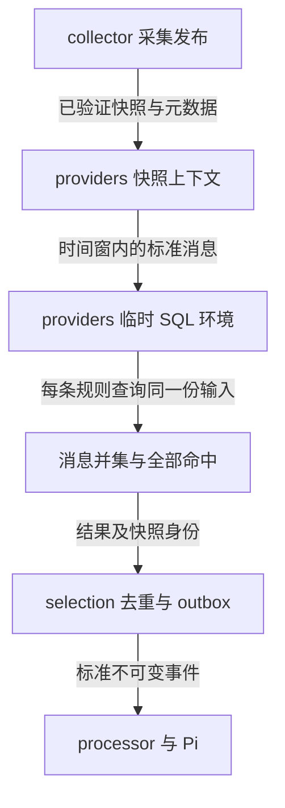

# 查询实现方法

快速查询复用现有 `collector`、`providers` 与 `selection`，不增加第二套 SQL 引擎。操作示例见 [快速数据库查询](../acquisition/fast-query.md)，规则字段见 [FILTERS.md](../../../FILTERS.md)。

## 调用链与职责



| 实现位置 | 职责 |
| --- | --- |
| [collector/service.py](../../../collector/service.py) | `collect_once` 刷新并发布元数据；`source_snapshot` 加锁并核对查询前后指纹 |
| [providers/query_registry.py](../../../providers/query_registry.py) | 注册来源快照工厂；内置 `_LocalSnapshot` 提供扫描、身份补全和采集水位 |
| [providers/platforms/](../../../providers/platforms) | QQ、微信表结构映射，以及时间窗、会话范围和邻居查询 |
| [providers/query.py](../../../providers/query.py) | 统一表、索引、参数绑定、只读 SQL、合并命中、身份补全 |
| [selection/](../../../selection) | 规则注册、筛选断点、稳定消息修订、事务和事件发布 |

采集失败时保留已验证旧快照。快照上下文阻止本项目刷新并检查其他写入造成的指纹变化；检测到变化就拒绝结果，不能把异常降为“没有消息”。它不会代替采集，也不是任意外部数据库的通用隔离机制。

## 标准 SQL 的输入输出

`query_rules(scope, window, rules)` 接收：

| 参数 | 字段 |
| --- | --- |
| `scope` | `provider_id`、`platform`、`account_id`，内置提供方还需要已加载的 `config` |
| `window` | 整数 Unix 秒 `start_inclusive`、`end_exclusive`，后者必须更大 |
| `rules` | 每项含稳定 `id`、`file`、`sql`、`params`、`recent_count` |

运行示例，使用已加载的来源配置：

```python
from providers.query import query_rules

scope = dict(provider_id=config.get('provider_id', config['platform']),
             platform=config['platform'], account_id=config['source']['account_id'], config=config)
result = query_rules(scope,
    dict(start_inclusive=start, end_exclusive=end),
    [dict(id='recent-files', file='inline.sql',
          sql='SELECT identity FROM candidates WHERE kind=:kind',
          params={'kind': 'file'}, recent_count=0)])
print(result['snapshot_id'], len(result['messages']), len(result['hits']))
```

返回 `snapshot_id`、`messages:[{identity,message_key,message}]`、`hits:[{identity,rule_id}]`。一条消息命中多条规则时消息只返回一次，命中来源全部保留。调用该入口只查询，不发布事件；正式发布复用 `selection`，不要在调用方自己生成修订号。

`messages` 含窗口及有限历史，`candidates` 只含本轮窗口。每条规则看到同一份完整输入，不能串联成逐步过滤。规则只返回一列名为 `identity` 的非空字符串，必须来自已加载消息。SQLite authorizer 拒绝写入、`ATTACH`、扩展加载以及访问未授权表；输入值用绑定参数，规则来源是本地受信任配置。

标准表已有复合索引 `(platform,account_id,conversation_type,conversation_id,sent_at,local_id)`，它适合带来源和会话等前缀的查询，不保证任意仅按时间过滤都能命中。来源平台索引与标准表索引是两件事：前者减少原始读取，后者加速本轮规则查询。建表、输入扫描和身份补全仍有成本。

## 新信息源如何接入

在应用启动注册 `register_query_provider(provider_id, snapshot_factory)`。工厂接收 `scope`，返回上下文管理器，进入后提供：

| 成员 | 要求 |
| --- | --- |
| `snapshot_id` | 能区分来源数据版本的稳定标识 |
| `scan(start,end,**kwargs)` | 标准消息迭代器，支持 `[start,end)`；按现有调用约定处理 `context` 和 `conversations` |
| `enrich(message)` | 补全最终选中消息涉及的身份资料 |
| `selection_window_end(requested_end)` | 可选，限制定时筛选不越过已采集水位 |

工厂负责资源释放、快照一致性和账号隔离。`query_rules` 还会核对每条消息的平台与账号；SQL 命中未知身份直接拒绝。附件通过独立提供方注册，不需要改 Pi 工具或在查询代码中硬编码新平台。完整事件及附件接入见 [提供方指南](provider-api.md)。

## 缓存与一致性边界

查询临时库在本轮结束关闭并删除，标准表不会持续驻留。采集发布元数据能避免为了显示“上次采集”而扫描聊天库；它不是 SQL 结果缓存。

新增缓存应绑定来源、账号、`snapshot_id`、窗口、SQL 和参数；身份、附件结果还要遵守各自有效性校验。筛选后附件准备会再次核对快照及采集水位，变化时应重试原窗口。失败不能推进筛选断点；附件缓存命中也不能跳过账号、路径与摘要检查。

后台负载探针和面板概览缓存是展示能力，不参与采集成功判断，也不作为查询快照一致性的依据。实现与测试范围见 [面板验收记录](../../design/runtime-monitoring/IMPLEMENTATION.md)。
