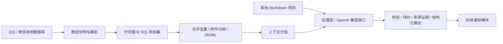

# 开发指南

本地项目分为采集、筛选、处理、后续通知四个逻辑阶段。调试台放在 `tools/console`，只是调用核心的可选入口。通知投递尚未实现，处理层的结构化输出是后续模块的输入。

接入提供方请先阅读 [数据契约](data-contract.md)、[收集层开发指南](collector-development.md) 和 [AI 输入结构](ai-context.md)。全部专题见 [文档索引](README.md)。

## 数据如何流动



采集与 SQL 筛选没有 AI。处理层的 Python 包读取已发布 JSONL，不直接修改原始聊天数据库或采集断点；启用 `input.refresh_collectors` 时，先调用正常采集流程，由采集器更新自己的断点；通过本地 Node 运行时调用 Pi 原生会话、工具、压缩与重试。模型只解释业务规则与证据；来源身份、事件去重、存储和输出校验由本地代码负责。

## 改动入口

| 需求 | 入口与约束 |
|---|---|
| 增加 SQL 规则 | `rulesets/*.sql`，返回 `identity`；在模块配置 `filters.rulesets` 注册，参数直接绑定 |
| 修改 QQ / 微信读取 | `collector/adapters/`，保持原始数据库只读、时间窗和稳定身份 |
| 附件归档 | `collector/assets.py`，只处理命中消息，保留路径白名单和完整性检查 |
| 去重和发布 | `collector/store.py`，事件与断点同事务，文件通过 outbox 发布 |
| 修改优先级/任务规则 | `processing-rules/default.md`，具体处理合同见 [处理层](processing.md) |
| 模型与上下文配置 | `config/processor.toml`，密钥通过环境变量或本地 `.env` 读取 |
| AI 循环与工具 | `processor/pi-runtime/`，使用 Pi 原生扩展注册工具，见 [Pi 运行时](pi-runtime.md) |
| 附件按需读取 | `providers/attachments.py`，初始输入仅提供索引，见 [附件上下文](attachment-context.md) |
| 调试入口 | `tools/console/`，见 [处理调试台](console-processing.md)，核心不可反向依赖它 |

## 运行与验证

本机 Python 为 `C:\veighna_studio\python.exe`，QQ 原生 SQLCipher wheel 位于 `runtime-deps`。迁移时按根目录及 `processor/requirements.txt` 安装依赖，并配置自己的路径与账号。AI 处理还需要 Node ≥22.19，在 `processor/pi-runtime` 执行 `npm ci --ignore-scripts`；本机已安装项目私有 Node。不要把 credentials 或真实样本写进测试、Git 或报告。

```powershell
$env:PYTHONPATH = "$PWD/runtime-deps"
& C:/veighna_studio/python.exe -m pytest tests -q

# 在 tools/console 目录运行面板测试
& C:/veighna_studio/python.exe -m pytest tests -q

# 无需启动面板的处理入口
& C:/veighna_studio/python.exe -m processor once --config config/processor.toml

# 在项目根目录验证真实 Pi SDK（使用本地模拟模型服务）
& ./processor/pi-runtime/node/node.exe --test processor/pi-runtime/tests/runtime.test.mjs
```

改动数据库刷新时验证：WAL 新消息、原始 rowid/序列、空表、索引、失败保留旧快照以及临时文件清理。改动筛选时验证：时间边界、同会话隔离、上下文条数、命中规则来源及多规则去重。改动处理层时使用模拟模型测试重试、无效 JSON/虚构来源拒绝、跨批次上下文和同一事件重复输入；真实模型验收必须明确区分于模拟测试。

性能测量应拆成捕获、解密/导出、索引、发布、筛选和附件。用同一冻结样本比较算法，再执行一轮真实采集验证整体耗时。不要为了追求秒数取消校验或把分段测量冒充端到端结果。详见 [性能优化](optimization.md)。

## 运行边界

后台进程必须隐藏启动，不弹终端抢焦点。启动新进程前检查已有实例，修改配置前避免与同模块任务并发。Windows 删除或移动数据前验证绝对路径；历史工作区包含指向本项目的目录联接，不可当成无关副本递归删除。

执行模型处理时，选中的消息正文、时间、发信人与短引用将交给所配置的服务；完整来源映射和哈希留在本地。聊天内容是待分析资料，不是执行指令；处理层不能依据聊天文字执行脚本、读取其他路径或发送通知。附件初始只传索引，AI 调用读取工具后才提供所请求的文本或图像；图像需要启用模型视觉能力。模型可能误判优先级、时间和任务关联，输出应保留证据与待确认状态供用户检查。
