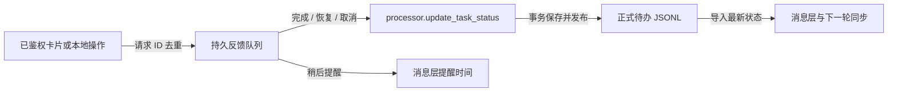

# 消息层：行动包、材料和提醒

消息层位于 `messaging/`，消费 `config/messaging.toml` 指定的正式待办 JSONL。内容同步不调用模型，也不刷新原聊天库；用户操作通过处理层公开状态 API 回写，渠道不得直接修改上游 SQL。状态、材料、投递队列和反馈队列由各自模块维护。调试台只是调用公共函数的可选客户端，自动运行见 [自动化](automation.md)。

## 输入与输出契约

输入沿用处理层已发布的 `schema_version=1` 任务事件：

```json
{
  "schema_version": 1,
  "event_id": "稳定事件ID",
  "operation": "upsert",
  "task_id": "稳定待办ID",
  "revision": 2,
  "task": {
    "task_id": "稳定待办ID",
    "revision": 2,
    "title": "填写并提交申请表",
    "event": "按通知要求完成申请表并提交到指定入口。",
    "action_steps": ["填写申请表", "核对材料并提交"],
    "priority": "P2",
    "priority_reason": "有明确期限的常规申请",
    "status": "open",
    "time": {"start": null, "deadline": "2026-11-20", "timezone": "Asia/Shanghai", "text": "11月20日前"},
    "people": [{"name": "申请同学", "role": "参与人"}],
    "location": null,
    "notes": [],
    "needs_review": false,
    "review_reasons": [],
    "sources": [],
    "materials": [],
    "attachment_evidence": []
  }
}
```

上例省略了实际来源；生产事件中的 `sources` 由处理程序从提供方事实生成，`materials` 与 `attachment_evidence` 包含 `{message_key, attachment_index, attachment}`。模型只提交短引用，不生成本地归档路径。`people` 是需要参与事项的人，负责人只是明确指派后的其中一种角色。

本层在输入边界校验结构。事件 ID 相同、内容不同或任务同修订内容不同均拒绝导入。多条旧修订可以乱序到达，最终任务只保留最高修订。`.tmp` 不读取，已经导入的 JSONL 必须保持不可变。坏批次不跳过后假装成功，应先检查并修复输入。

输出行动包包含稳定任务身份、执行步骤、参与人员、时间、地点、执行说明、精简来源和材料索引。`notes` 保存缺失入口、材料不可读等简短事实，任务直接入库，不等待人工复核。`needs_review=false` 与 `review_reasons` 仅为兼容旧客户端保留；旧原因降级为说明。修订号用于协议幂等与冲突检测，不在业务界面展示。

`sources[].text` 保留被引用消息的原文，不由模型改写。飞书折叠来源区与本地面板按群名、发信人、时间、原文展示，原有换行保留。卡片中的原文总预算为 2000 字符，超过时明确提示查看 `来源原文.txt`；完整文本由消息层归档，并通过已有材料投递、下载和校验机制提供。预览不写文件；关闭文件发送时可在本地面板查看完整原文或下载。原文对外提供，内部数据库路径、凭据和未引用的聊天内容仍不进入行动包。

外部 `envelope` 提供 `delivery_id` 与 `kind=upsert|reminder`；自动化故障通知使用 `kind=alert`，没有业务待办操作按钮。字段映射和回执示例见 [渠道契约](messaging-channels.md#外部工作流契约)。信息整理和渠道映射是确定性的，不额外建立 AI 信息处理层。

## 材料生命周期

1. 从 `materials` 和确实被引用的附件证据建立执行材料清单。同一来源消息的其他附件不自动发送。旧任务只有消息来源、没有材料关联时保留未选择数量；重新处理可补齐关联，不偷偷上传全部附件。
2. 预览只读校验已有归档；本地 `sync` 按允许目录和 SHA-256 校验后复制到消息层内容寻址目录，不使用指向可变原件的硬链接。
3. 同内容跨任务复用一个文件，清单保留各自名称、来源、用途和角色。数据以临时文件写入并校验后原子发布，校验失败不作为可读材料外发。
4. 缺原件、密文、无法验证的附件显式不可用。本层不再自行解密；附件读取/解码仍走上游提供方，补齐后任务新修订或同修订可见材料变化会触发资料同步。
5. 用户可用 `attach-result` 显式选择成果文件，`role=result` 和说明保存在独立结果表。完成、取消或后续修订不会删除它们。
6. 下载只接受已有任务和材料编号，重新核对路径范围和文件哈希。外部请求不接受任意本地路径；远程部署需由接入模块上传材料到目标平台或对象存储。

默认目录 `data/messaging/assets/<sha256前两位>/<sha256>`，名称不作为存储路径。归档文件保留到用户另行管理；当前无自动垃圾回收，防止完成后误删证据。备份应同时包含 `data/messaging/state.db`、材料目录和上游正式待办 JSONL。Notion 上传收据与本地材料分离；外部副本同样不会因为本地完成而删除。

## 提醒与恢复

`schedule.interval_seconds` 是检查间隔。有截止时间时，`deadline_reminders` 按优先级提供截止前节点；没有截止时间或该机制关闭时，使用 `reminders.P0..P4` 中的普通间隔，两套不会同时催办。截止提醒不调用模型。

| 优先级 | 默认截止提醒节点 |
|---|---|
| P0 | 1 天、6 小时、2 小时、30 分钟、截止时 |
| P1 | 6 小时、2 小时、30 分钟、截止时 |
| P2 | 2 小时、30 分钟、截止时 |
| P3 | 30 分钟、截止时 |
| P4 | 截止时 |

配置 `deadline_reminders.enabled=true`，`P0..P4` 为提前秒数数组，`0` 表示截止时，空数组表示该优先级无截止提醒。面板“消息通道与自动投递”中用提前分钟编辑：如 P0 为 `1440, 360, 120, 30, 0`。日期只有年月日时，按任务时区（缺省使用 `deadline_reminders.timezone="Asia/Shanghai"`）当日 **23:59:59** 安排；卡片会说明这是提醒规则，未把它声称为原消息提供的具体时刻。

提醒仅针对未完成事项；完成、取消、替代停止催办，改期后按新日期计算，稍后提醒期间不发送。节点通过稳定投递 ID 和已成功回执去重；同一节点之后已经成功发送的新建/更新卡片也视为覆盖该节点，避免紧接着再提醒一次。某节点失败仍使用原投递记录有限重试；更晚节点已到时，尚未发出的早期节点及其重试失效，只保留最近一次。结果未知时仍需对账，不擅自重发。

检查时间存在最多一轮轮询延迟。机器休眠/关机不会发送，恢复后只补最近已到节点，不连发全部错过节点；截止时节点成功后不再无限重复催办。普通间隔的 `0` 表示不重复提醒。当前没有静默时段或手机推送必达承诺，可由外部工作流补充。

Notion 和 `mode="sync"` 的目标只同步内容或状态变化。初次本地已经完成的任务仍可进入资料库；通知渠道不首次催办已结束任务。完成、取消、替代停止周期提醒；稍后提醒抑制催办。新处理修订不会默默清除用户的完成标记；需要用户显式恢复。

每次请求前持久化 `sending`，成功后保存回执。网络断开或进程崩溃无法确认远端是否成功时标记 `unknown`，同任务/目标后续投递暂缓；明确拒绝则指数退避，达到上限保留 `failed`。SQLite 事务无法包住远程请求，所以不承诺全平台恰好一次。

```powershell
python -m messaging status
# 核对远端后，明确选择重试或确认已送达；重试不更换 delivery_id
python -m messaging resolve-delivery --delivery-id "投递ID" --resolution retry
python -m messaging resolve-delivery --delivery-id "投递ID" --resolution delivered
```

Notion 需要页面回执，不能缺回执直接标记送达；重试时适配器先按 Task ID 查询对账。通用接入方应将 `delivery_id` 去重和远程对象映射持久化，再返回成功。飞书应用卡片操作已接入下述反馈队列；Notion 页面或日历中的原生编辑尚未自动回流。

## 操作反馈与状态回写

卡片操作、本地调试台和命令行都先将请求保存到 `data/messaging/feedback.db`。立即返回的 `queued` 只表示收到；应用成功后才是 `applied`。飞书接入负责官方事件验签、目标与操作者校验；消息正文不能替代授权事件。



| 操作 | 应用位置与结果 |
|---|---|
| `complete` / `reopen` / `cancel` | 调用处理层公开 API，写入 `completed` / `open` / `cancelled` 并发布状态事件 |
| `snooze` | 只调整消息层提醒时间，不修改任务内容或完成状态 |
| 重复回调 | 同一目标、事件 ID 返回相同入队回执；内容不一致拒绝 |
| 状态冲突 | 不覆盖较新的任务；保留 `conflict` 供检查 |
| 临时失败 | 同任务按顺序处理，有限退避；数据库占用暂缓，不消耗业务失败预算 |
| 失败耗尽 | 保留 `failed`，不会下一轮无限重试；显式 `retry_feedback` 恢复 |

未应用、失败或冲突的反馈会暂缓该任务的后续提醒，避免用户已点击完成却继续收到催办。新的有效操作应用后，可替代同任务更早的失败反馈。任务自身仍可查看、材料仍保留；这属于操作故障恢复，不是待办人工复核流程。

`messaging once/run` 会先处理反馈；独立自动化也可用 `jobs.feedback` 周期调用 `process_pending`。该函数不调用模型。配置 `[feedback]` 的 `enabled`、`state_file`、`processor_config`、`max_attempts` 和 `retry_base_seconds`。

```powershell
python -m messaging feedback-status
python -m messaging retry-feedback --request-id "反馈请求ID"
```

处理层公开函数为 `processor.update_task_status(config, task_id, status, request_id=..., actor=..., expected_revision=...)`。`actor` 包含 `platform/user_id/source`，`request_id` 由调用方持久保存用于重试，`expected_revision` 可用于检测过期操作。函数保存幂等回执并通过既有 outbox 发布，不请求模型，也不允许恢复已被替代的旧任务。普通接入方优先使用下方消息层排队接口。

## 公共入口

```python
from messaging import load_config, preview, sync, run_round, status
from messaging import request_task_action, process_pending, feedback_status, add_result, task_package

config = load_config('config/messaging.toml')
preview(config)                         # 无写入、无网络
sync(config)                            # 导入与归档，无网络
run_round(config)                       # 只有已启用目标才可能投递
request_task_action(config, task_id, 'complete')  # 先入队，返回 request_id
process_pending(config)                        # 应用状态，不调用模型
feedback_status(config)                        # 查看已应用或失败结果
add_result(config, task_id, file_path, note='填写后的申请表')
package = task_package(config, task_id)
```

`set_task_state` 仍保留为消息层本地覆盖的兼容接口；接入按钮或外部操作应使用 `request_task_action`。反馈功能显式关闭时，后者退回本地覆盖，不能据此声称正式待办状态已回写。

可选面板提供 `/api/messaging/status`、`preview`、`sync`、`feedback`、`tasks/{id}/state` 与 `tasks/{id}/materials/{resource_id}`，以及只读 `/api/automation/status`、`check`。通道配置、合成测试发送、自动化启停和投递恢复由 `/api/operations/` 提供，见 [通道管理](messaging-management.md)。这些接口复用本机来源检查与 `X-Console-Token`；本地调试令牌不是适合公网部署的长期访问凭据。

扩展渠道优先注册 `kind="webhook"` 接 n8n 或已有模块，复用稳定契约；确需进程内插件时，在 `channels.deliver` 加显式分发与对应测试。接口、注册位置和验收要求见 [渠道开发指南](channel-development.md)。只有本地配置决定运行什么代码，消息正文不能选择插件。新增提供方无需修改处理规则、采集 SQL 或 Pi 工具。

验证覆盖事件重复/乱序/冲突、来源状态库隔离、提醒间隔与完成状态、素材校验及存续、投递退避/未知结果恢复、真实 Notion SDK 的本地模拟响应。尚未配置的外部账户与 OAuth 工作流需另行联调。
