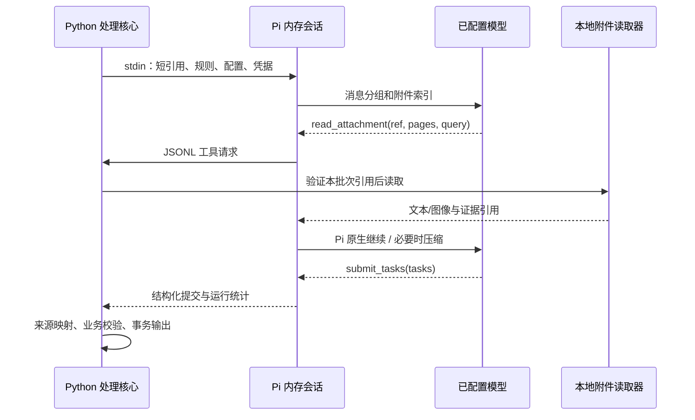

# Pi 原生处理运行时

AI 循环采用开源 **Pi coding-agent SDK**，没有自己实现模型/工具轮询器。Python 负责输入整理、本地附件边界、来源映射与最终业务校验；Pi 负责请求模型、执行工具、继续推理、上下文压缩和重试。

## 来源与版本

| 组件 | 固定版本 / 来源 |
|---|---|
| `@earendil-works/pi-coding-agent` | `1.5.2`，MIT，[npm](https://www.npmjs.com/package/@earendil-works/pi-coding-agent/v/1.5.2) |
| `@earendil-works/pi-ai` | `1.5.2`，MIT，同一上游 |
| 上游仓库 | [earendil-works/pi](https://github.com/earendil-works/pi)，实际接口以安装包内 `docs/`、`examples/sdk/` 和类型声明为准 |
| Node.js | 本项目私有 Windows x64 `v22.23.5`，不修改全局 Node |
| 依赖锁 | `processor/pi-runtime/package-lock.json`，本地安装，未运行安装脚本 |

旧命名空间 `@mariozechner/pi-coding-agent` 已被上游弃用。本项目最终使用维护中的 `@earendil-works`，不是最初调查的旧 `0.73.1`。

私有 Node 位于 `processor/pi-runtime/node/node.exe`，由官方发行版提供。已独立比对 [官方 SHASUMS256.txt](https://nodejs.org/dist/v22.23.5/SHASUMS256.txt)：

```text
win-x64/node.exe
247e9693d316da9857e44990e5e11709f596f18112251b8026ec6eed80bdf38a
```

`node/` 和 `node_modules/` 不进入 Git。迁移机器时需要 Node ≥22.19，并在 `processor/pi-runtime` 执行 `npm ci --ignore-scripts`。Python 优先使用项目私有 Node，缺失时才使用 PATH 中的 Node。

## 执行边界



每个批次创建独立的 `SessionManager.inMemory()`。认证、设置和模型目录均使用内存存储，不加载全局认证、技能、扩展、提示模板、项目上下文文件或默认 MCP。模型目录的自动网络刷新关闭。

SDK 的默认 `read`、`write`、`edit`、`bash`、`powershell` 等工具全部不开放。启动后还会检查真实启用的工具名单，只允许下面三项。聊天或附件要求“读取某路径”“运行命令”不会变成额外权限。

凭据只通过子进程 stdin 传入，命令行参数不含密钥。选定的密钥环境变量从子进程环境中移除，避免旁路继承；Pi 仅持有本次内存凭据。stdout 仅用于结构化协议，原始 stderr 不转发到网页或业务错误。Windows 子进程使用 `CREATE_NO_WINDOW`，不会弹出终端抢焦点。

## 原生扩展与工具

`collector-extension.mjs` 通过官方 `extensionFactories` 加载，内部使用 `pi.registerTool()`。不是另造一套插件或工具调度框架。

| 工具 | 范围 |
|---|---|
| `read_attachment(ref, pages?, query?)` | 仅接受初始附件目录中的短引用，页范围如 `1-3,5`；调用本地已登记的附件读取器，不接受路径 |
| `find_related_tasks(...)` | 按需实时查询完整待办库，支持平台、账号/会话短引用、关键词、关联人物、时间、状态、优先级与分页；参数见 [待办查询](task-search.md) |
| `submit_tasks(tasks)` | 通过来源及结构校验后提交业务 JSON，调用 Pi 原生 `terminate:true` 结束运行；可修正错误返回工具反馈，由原生循环重提 |

最终 `sources` 只能引用本次消息 `m1` 等短引用，或附件工具实际返回的 `f1:p2`、块引用。没有读取过的页不能凭模型猜测引用。原始数据库定位、哈希、文件路径和完整来源映射留在 Python 层。

有依据的任务直接入库，不设置人工复核流程。`notes` 承载影响执行的说明，`needs_review=false` 和旧 `review_reasons` 保持兼容。附件工具仍可能返回名为 `needs_review` 的读取诊断；它不要求用户批准任务。用户在飞书或本地完成任务通过公开状态 API 处理，不新增模型工具或模型调用。

文本模型默认 `model.vision=false`。只有明确开启视觉能力后，工具才允许把已授权附件的图像块交给模型；原生 Pi 负责转换为兼容接口的视觉消息。未读、部分读取和不可读状态由 Python 处理核心如实记录；不强制完整阅读所有附件，也不因空待办而中止整批，运行时不会把工具错误包装成“附件里没有任务”。

## 原生压缩、重试和预算

| 配置 | 默认值 | 行为 |
|---|---:|---|
| `model.context_window` | 32768 | 告知 Pi 该模型可用上下文 token 上限，必须按实际模型能力设置 |
| `model.max_output_tokens` | 4096 | 单次模型输出 token 上限 |
| `agent.auto_compaction` | true | 启用 Pi 原生自动压缩，在下一次请求前检查上下文 |
| `agent.compaction_reserve_tokens` | 8192 | 原生压缩触发时预留空间 |
| `agent.compaction_keep_recent_tokens` | 4096 | 原生压缩尽量保留的近期内容 |
| `agent.max_retries` | 2 | Pi 会话/摘要的原生重试次数；底层 provider 重试设为 0，避免两层相乘 |
| `agent.max_turns` | 8 | 普通 agent 回合上限 |
| `agent.max_tool_calls` | 12 | 工具调用次数上限，包含提交工具 |
| `model.timeout_seconds` | 120 | 整个 Pi 运行的墙钟预算，包含压缩与重试 |
| `processing.max_input_chars` | 60000 | 初始消息与规则的字符预算，用于批次打包；不限制后续工具历史 |

压缩使用 Pi 自身的摘要和历史保留机制，没有自写 summarizer。附件证据准入集合、短引用映射和最终提交状态保留在进程内，不能被摘要“创造”或绕过。自动压缩仍需要额外模型请求和费用，也可能损失措辞细节；完整原文与附件证据在本地来源中保留。

`processing.max_input_chars` 只约束初始消息批次。已取消每次 provider 请求的额外字符拦截：工具结果、调用历史和压缩请求交给 Pi 按 `model.context_window` 原生管理，不再用字符数代替 token 容量。初始批次超限仍报 `context_budget`；原生压缩失败报 `compaction_failed`。附件按页读取、解析资源限制、回合/工具次数和超时限制继续生效。

运行统计 `_agent` 包括运行时/版本、普通回合数、工具调用数、成功压缩次数、Pi 会话重试次数、观测到的最大请求文本长度，以及已返回的附件证据引用。压缩请求不算普通 agent 回合，但仍受整体超时和模型容量约束。

## Python 接口和进程协议

```python
from processor.pi_bridge import run_agent

result = run_agent(
    config, system_prompt, model_payload,
    api_key=local_key,
    attachment_reader=attachment_context.read_attachment,
    existing_tasks=related_task_summaries,
)
```

`model_payload` 支持 `conversations[].segments[].messages[]`，并兼容单会话 `segments[]`。消息 ID、附件 ID、已有任务 ID 都是本批次短引用。

stdin 首行传入运行参数；之后 Python 只回答 `{type:"tool_result", id, result}`。Node 发送 `{type:"tool_request", name:"read_attachment", id, arguments}`，最终发送 `{type:"result", result}` 或已脱敏 `{type:"error", code}`。这个桥只搬运工具数据，不决定模型下一轮、不重写 Pi 的循环。

扩展新能力时，在 Pi 原生扩展中注册明确的工具和参数边界；Python 只增加必要的本地受限操作。不要开放任意路径、任意 shell、动态下载技能或让模型直接修改任务数据库。

## 验证

本地合成 OpenAI 兼容 SSE 服务驱动**真实 Pi SDK**，验证了：附件读取 → 已有任务查询 → 最终提交、终止后不多请求、多个会话短引用、视觉图块、未知工具和虚构证据拒绝、工具/回合/时间预算、长工具内容触发原生压缩、压缩后来源仍有效、原生重试、初始批次限额，以及工具历史超过初始预算后仍可继续。另有 Python → Node → 本地附件回调的真实子进程测试。

```powershell
# 在 processor/pi-runtime 下
.\node\node.exe --test tests/runtime.test.mjs

# 在项目根目录
python -m pytest tests/test_pi_bridge.py -q
```

这些测试没有把真实聊天发送到外部服务，不代表具体模型的中文任务理解质量。实际服务还需支持 OpenAI 兼容流式 tool calling，并按其真实上下文大小配置；不支持的接口会明确失败。

## 本机大上下文配置与实时事件

当前 Flash 配置为 1,000,000 tokens 上下文、384,000 tokens 最大输出；压缩预留 384,000 tokens，与输出上限对齐，保留近期 64,000 tokens。单会话 100,000 字符、初始批次 300,000 字符、200 条消息软限，单批最多 32 回合、128 次工具调用、600 秒。上述是本机显式配置，通用默认值仍适用于小上下文模型。压缩预留越大，触发越早；近期保留量并非摘要长度。

`session.subscribe()` 原生事件与 `before_provider_request` 指标通过 JSONL 传回 Python；可选调试台把事件写入该任务目录的 `pi-events.jsonl`。页面实时显示回合、工具开始/返回、附件短引用及页码、请求字符数、压缩开始/结束和重试。事件仅包含必要状态，不保存模型思考文本、聊天/附件全文或凭据。每个 Pi 批次有独立 run_id。关闭面板不影响核心处理；未配置事件文件的独立核心不写此日志。
