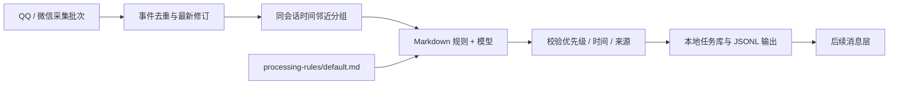

# 处理层：从消息到可追溯待办

处理层读取采集层已经输出的 JSONL，用本地 Markdown 规则指导 OpenAI 兼容模型整理待办。采集、SQL 筛选仍然没有 AI；处理层不修改 QQ/微信原库，不依赖调试台，也不发送通知。



## 文件与启动

| 位置 | 用途 |
|---|---|
| `processor/` | 处理层核心，业务编排与来源校验；AI 循环由 Pi SDK 实现 |
| `config/processor.toml` | 输入、存储、模型、分组与调度配置 |
| `processing-rules/default.md` | 用户可直接编辑的规则全文 |
| `data/processor/state.db` | 输入事件、最新消息、已处理分组、任务、待输出队列 |
| `data/todos/*.jsonl` | 提供给下游的结构化待办修订 |
| `examples/processed-todo.json` | 明确标注的合成结构示例，不是真实模型效果 |
| `tools/console/` | 可选调试入口：配置、规则、上下文预览、执行和结果 |

在项目根目录执行：

```powershell
# 查看当前配置与已持久化统计，不调用模型
python -m processor status --config config/processor.toml

# 读取输入并预览前五组，不保存状态、不调用模型
python -m processor preview --config config/processor.toml

# 配置模型后，处理一轮；或持续按配置间隔执行
python -m processor once --config config/processor.toml
python -m processor run --config config/processor.toml
```

无需安装调试台或 Web 依赖。处理层使用官方 Pi SDK 原生会话循环、工具调用、自动压缩与重试；接口需支持 OpenAI 兼容流式 tool calling。运行环境与安装见 [Pi 运行时](pi-runtime.md)，附件依赖为 `processor/requirements.txt`。不自写模型轮询，不降级成关键词算法或伪造结果。

## 模型与本地凭据

API 地址与模型名在 `config/processor.toml` 配置。凭据读取顺序为系统环境变量 → 项目根 `.env` → `secrets/processor-api-key.txt`。`.env` 写 `CHAT_PROCESSOR_API_KEY=实际密钥`；密钥文本文件只写密钥原文。`.env` 和 `secrets/` 均已忽略，不进入 Git，接口和日志不返回密钥。缺少凭据时不执行模型。

后台进程读取的是启动时继承的环境变量。使用环境变量时需要重启相关进程以接收变更；使用已配置的密钥文件时，下次调用直接读取新值。清空两个凭据配置项仅适用于不需要认证的本地兼容接口。

初始输入仅包含短会话/消息引用、平台、时间、发送者、正文及附件索引。真实消息 hash、数据库路径、归档路径、账号和群 ID 映射、SQL 实现说明保存在本地。工具读取后才把选中正文/图片送给配置的服务；因此配置远程模型后，相关内容会离开本机。

## SQL 选取、会话长度和合批

1. 采集时间窗内分别执行 `mentions-all.sql`、`files.sql`、`context.sql`（前后各五条），合并去重；关键词仍只匹配当条正文。当前两个模块已移除 `all.sql`。
2. SQL 暂存完整候选序列，再为选中消息附上原序列的前驱标识。处理层据此保留连续片段和真实缺口，不把筛选后的相邻项冒充原会话连续。
3. 按平台、账号、会话隔离并稳定排序；`context.grouping="sql"` 为默认。一个完整片段不按条数硬切。没有序列证明的旧数据保留独立边界。
4. `context.max_conversation_chars` 默认 20000，约束单会话消息输入的字符预算（正文、发送者、附件名称及序列化预留；不是 token 数）。`max_messages` 是打包软限；完整片段可超过软条数，但不能超过字符上限。片段本身过大时明确报错，保留全部内容，用户可提高预算或调整 SQL 范围。
5. `agent.batching="auto"` 按总预算合并多个会话，一个请求内用 `conversations` 明确隔离；超过总预算则优先按会话拆。`single_conversation` 保留为手动选项。`processing.max_input_chars` 默认 60000，限制初始消息批次；后续工具历史交给 Pi 原生上下文管理，图片另受解析与视觉能力限制。
6. 每批次创建独立 Pi 内存会话；工具调用后原生上下文压缩可继续管理不断增长的内容。压缩不会删除本地原文或来源映射。

本机已设置 `input.start_at` 为启用时刻：早于此时的消息不独立触发历史任务，只有之后重新被 SQL 选中的必要前文可以作为历史背景。原采集数据不删除。需要回溯时显式修改起点并重放相应采集时间窗，不通过首次启动自动处理全部历史。配置省略起点时为 0，代表显式兼容旧的全历史范围，部署新副本时请设置起点。

旧配置可显式使用 `grouping="time"` 兼容时间段分组，但当前实际部署使用 SQL 模式，不追加第二套时间邻近和额外上下文选取。

## 初始输入、附件和来源

模型初始数据是 `timezone + conversations[].segments[].messages[] + attachments`。每条消息只提供 `id=m1`、时间、发送者、正文及附件短引用；附件只提供 `ref=f1`、名称、类型、可用状态等索引。**初始不注入附件正文或图片。**

Pi 原生扩展提供：`read_attachment` 读取 PDF 页、DOCX 段落/表格、DOC 转换结果或图像；`find_related_tasks` 实时查询完整待办库；`submit_tasks` 提交最终结构化结果并结束循环。附件解析使用 PyMuPDF、python-docx、Pillow 和本机 LibreOffice，见 [附件上下文](attachment-context.md)。

模型通过 `sources:["m1","f1:p2"]` 指出依据。程序核对证据确实存在、附件确实读过，再映射回真实消息身份和附件位置。不能将不同会话的证据拼成一个任务。只读取判断任务所需的附件内容；允许跳过无关附件，也允许提交空任务。仅当任务判断所需证据缺失时标注具体复核原因。模型未开启视觉能力时，扫描页/图片明确待复核，不冒充已识别。

查询工具按参数直接查询已保存的完整待办库，不受预加载最近 40 项候选的限制。默认范围覆盖全部平台、账号和会话，仅返回请求页；可组合关键词、关联人物、时间等筛选。历史采集消息尚未生成待办时不属于查询对象。查询结果注册为本轮稳定短引用，允许更新明确相同的跨平台事项并保留旧来源，详见 [待办查询](task-search.md)。

## Markdown、P0–P4 和拆分

`processing-rules/default.md` 是可直接编辑的 UTF-8 Markdown。当前提供可修改的默认优先级解释，以及“时间、人物、地点、事件”的提取要求。规则不是代码，不支持执行 shell、SQL 或网页操作。

- 一个通知可以拆成多项任务；同一事项的补充、改期和取消可更新原任务。
- 发信人保留在来源里，不自动等于负责人。
- 相对时间以相应原消息发送时间和配置时区为基准，不能用模型调用时间替代。
- 开始和截止时间可为带时区的 ISO 时间、精确到日的 ISO 日期或 `null`。保留原始时间表述；无法确定时留空并复核。
- 人物未知用空数组，地点未知用 `null`。缺少参与人员或截止时间时，核心额外加入复核原因，避免被模型静默补全。
- `priority` 严格限制为 P0、P1、P2、P3、P4；`priority_reason` 记录本次依据。

规则全文 SHA-256 与模型地址、模型名、视觉能力、上下文参数和运行时协议版本一起参与本地分组指纹；这些 hash 不进入模型提示。编辑规则后，已有组会重新成为待处理项，可能产生 API 费用；不是仅对下一条新消息生效。每轮默认最多处理 10 组，可在 `processing.max_groups_per_round` 修改。超长完整片段会明确失败，不截断证据；可调整 SQL 范围或提高明确预算。Pi 原生压缩负责运行中的历史，不能把片段硬切变成“已经完整处理”。

## 输出结构与来源

每行是 `operation=upsert` 的任务事件，包含 `event_id`、`task_id`、`revision` 和 `task`。

| `task` 字段 | 含义 |
|---|---|
| `title` / `event` | 简短动作 / 事项详情 |
| `priority` / `priority_reason` | P0–P4 及依据 |
| `status` | `open`、`cancelled` 或 `superseded` |
| `time` | 开始、截止、时区、原话 |
| `people` / `location` | 参与本事项的人及角色（不等于负责人） / 地点 |
| `action_steps` | 有原文依据的执行步骤，历史任务可为空 |
| `needs_review` / `review_reasons` | 人工核对需求和具体原因 |
| `source_message_keys` / `sources` | 支撑结论的原消息及完整本地来源 |
| `attachment_evidence` | 程序补全的附件位置、所属消息、归档引用；后续改期仍保留原证据 |
| `context` | 分组 ID、主体/历史消息 key、连续性限制 |
| `processing` | 规则文件/hash、模型、输入指纹、处理时间 |

`sources` 由本地核心从原事件组装，模型不能自填数据库地址或伪造来源。每项含采集模块和详细说明、账号、会话、原消息 ID、原发送者、发送时间（Unix 和本地 ISO）、收集时间、原文、附件归档引用、原数据库/表/local_id、命中 SQL 规则和原时间窗。发信人无法识别时保留空 ID；不冒充姓名。附件仍由采集层归档，此处只引用，预览不移动或复制文件。

## 去重、修订和失败恢复

| 边界 | 处理方式 |
|---|---|
| 同一采集事件重复投递 | `event_id` 主键跳过；相同 ID 内容冲突则报错 |
| 消息乱序修订 | 只接受更高 `revision`；相同修订不同内容拒绝 |
| 不变的处理输入 | 分组指纹相同则不请求模型、不重复输出 |
| 后续补充同一事项 | 模型复用提供的已有 `task_id`；核心合并来源并递增任务修订 |
| 重新提取后原组任务不再存在 | 输出 `superseded` 修订，保留原历史事件，不物理删除 |
| 迟到消息导致分组重排 | 提供来源相关的旧任务 ID；所有当前分组成功后才停用失效组结果 |
| 模型超时/JSON/来源/字段校验失败 | 不标记该组成功；下一轮重试，之前成功的组保留 |
| 输出磁盘写入失败 | 任务与待输出事件已同事务持久化；下次先补导出，不重新请求模型 |
| 两个程序同时执行 | 复用状态文件锁拒绝第二个写入者；只读预览仍可使用 |

新任务 ID 根据首次成功输入和响应中的条目位置生成；后续关联依靠模型复用已有 ID。核心能保证输入、修订、输出事件层面的幂等，**不能保证模型永远正确识别两个不同说法是同一事项**。没有复用 ID 的重新提取可能形成新 ID 和旧 ID 的 `superseded` 修订，供下游明确更新。跨群、跨平台查到同一事项后可以复用已有 ID 更新，保留原始归属和各平台来源；程序不因标题或人名相同就自动合并。

输出临时文件以 `.tmp` 结尾，写完并刷新后才原子改名为 `.jsonl`。下游忽略临时文件，按 `event_id` 去重、按 `task_id + revision` 更新；`superseded` 应从活跃清单移除。不可把每个 upsert 都当成新任务通知。

状态接口只报告已持久化消息/任务数，以及最近一次处理时的待处理数量和时间；不会因调试台轮询而反复读取全部批次。精确的当前待处理范围通过显式“预览”取得。

## 开发与验证

公共调用接口：

```python
from processor import load_config, preview, run_round, status, list_tasks

config = load_config("config/processor.toml")
context_preview = preview(config, limit=5)   # 只读、不联网
current_status = status(config)             # 轻量统计
result = run_round(config)                  # 配置模型后显式执行
tasks = list_tasks(config, limit=20)
```

在 `tests/test_processor.py` 中使用合成消息和替换后的模型调用，不需要真实凭据。测试覆盖乱序/重复输入、跨批次关联、历史背景边界、消息来源、错误模型输出、规则重提取、迟到重组、超出最近 40 项的来源相关旧任务、输出失败恢复、空发送者及配置错误。

```powershell
python -m pytest tests/test_processor.py -q
```

扩展时优先增加明确输出字段及校验，并同步测试、调试页面和本说明。不要让模型直接写采集库、执行文件、修改规则或发送通知。当前支持按工具请求读取附件正文和视觉图像，没有安装额外 OCR 引擎，消息层的通知与处理独立配置，见 [消息层](messaging.md)。模拟测试不能代替真实模型质量验收；服务需支持流式 tool calling，模型上下文容量与视觉能力应按服务实际情况配置。
